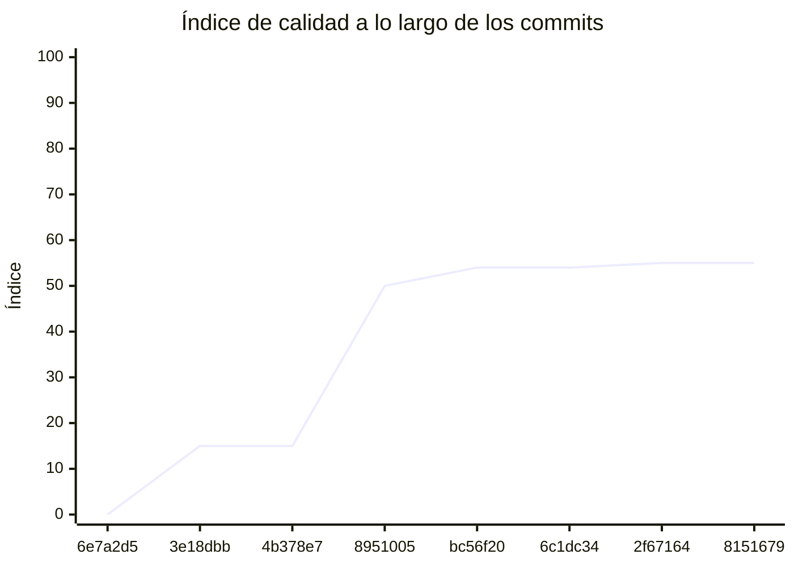

<!-- evaluacion:inicio -->
# Evaluación — Programacion2-IgnacioMilutin-2026/turnos_service

> Documento **generado automáticamente** por la cátedra de Programación II (UM): RepoSense + análisis de calidad de **7 dimensiones**. **No editar a mano**: se regenera en cada evaluación.
> Rama evaluada: `main`. Análisis **heurístico** (regex + métricas) + build: es una criba para orientar la revisión, **no una nota**. La **documentación** del repositorio no se evalúa.
> Generado: 2026-11-12.

## 1. Veredicto

| Aspecto | Resultado |
|---|---|
| Índice de calidad | **66/100** |
| Tipo de repositorio | `backend` |
| Build (`mvnw verify` / `gradlew check`) | OK |
| Código (LOC) | 27,869 |
| Archivos de código | 431 |
| Clases | 553 |
| Código dentro de clases (%POO) | 83% |
| Funciones fuera de clases | 0 |
| Duplicación (puerta) | 4.3% |
| Duplicación lógica | 4.6% |
| Duplicación de boilerplate | 15.4% |
| Cobertura | 98% |

> Este informe **describe** lo que el análisis midió con los criterios ya establecidos de la materia. No es una nota.

## 2. Semáforo de aprobación

Criterios de la cátedra (`CRITERIOS-CALIDAD.md`): **Aprobar** se juega con el perfil `estandar`; **destacar**, con el `exigente` (meta de excelencia).

| Semáforo | Resultado |
|---|---|
| Aprobar (`estandar`) | **no cumple** — 4/11 |
| Destacar (`exigente`) | **no cumple** — 4/11 |

**Para aprobar, falta cumplir:** SOLID; Duplicación; SEC; SQL

**Para destacar, falta cumplir:** SOLID; Duplicación; SEC; SQL

## 3. Autoría (RepoSense)

| Autor | Commits | Código (LOC) | Tests (LOC) | Docs (LOC) | Días activos | % del código |
|---|---:|---:|---:|---:|---:|---:|
| Ignacio Milutin | 108 | 9,252 | 24,063 | 12,049 | 24 | 100% |

> _El LOC de autoría lo calcula RepoSense sobre el historial y puede diferir del LOC de código del análisis (que mira el estado de `main`)._

## 4. Dimensiones evaluadas

Cada dimensión indica **qué mide**, **por qué importa** y **tu resultado**. Cuando el puntaje queda por debajo de la referencia, se agregan preguntas para **investigar la causa** (no hay recetas).

| Dimensión | Peso | Puntaje |
|:--|--:|--:|
| **D1** Diseño OO, SOLID y patrones (20%) | 20% | 1 |
| **D2** Arquitectura hexagonal — backend (15%) | 15% | 100 |
| **D3** Frontend KMP: MVVM y buenas prácticas (10%) | 10% | N/A |
| **D4** Integración y contrato (10%) | 10% | 90 |
| **D5** Seguridad y robustez (10%) | 10% | 0 |
| **D6** Pruebas y cobertura (20%) | 20% | 100 |
| **D7** Proceso y entrega (15%) | 15% | 100 |

### D1. Diseño OO, SOLID y patrones (20%)

- **Qué mide:** Métricas orientadas a objetos (clases, métodos, campos, cohesión, acoplamiento, herencia) y proxies de SOLID, más patrones de diseño.
- **Por qué importa:** El eje de la materia es el buen uso de la POO y su arquitectura: un diseño con clases claras y poco acopladas es más fácil de entender, probar y cambiar.
- **Tu resultado:** **1/100**
- **Para investigar la causa:**
    - ¿Se pensó el modelo de clases antes de codificar o se agrupó después?
    - ¿Qué clases concentran muchas responsabilidades a la vez?
    - ¿Los colaboradores llegan como parámetros o se crean por dentro?

### D2. Arquitectura hexagonal — backend (15%)

- **Qué mide:** Separación en capas (dominio, puertos de entrada/salida, adaptadores) y dirección de las dependencias del backend.
- **Por qué importa:** Aislar el dominio de la infraestructura permite cambiar la base de datos, el framework o el transporte sin tocar las reglas de negocio.
- **Tu resultado:** **100/100**

### D4. Integración y contrato (10%)

- **Qué mide:** Cumplimiento del contrato de integración de la cátedra (formato de errores, paginación, autenticación, endpoints esperados).
- **Por qué importa:** Los servicios deben poder integrarse entre sí y con la app sin sorpresas; el contrato es lo que hacen cumplir las pruebas de integración.
- **Tu resultado:** **90/100**

### D5. Seguridad y robustez (10%)

- **Qué mide:** Credenciales embebidas, consultas SQL por concatenación, y presencia de config de entorno; aislamiento de secretos.
- **Por qué importa:** Un secreto en el repositorio o una consulta construida por concatenación son riesgos concretos, no hipotéticos.
- **Tu resultado:** **0/100**
- **Para investigar la causa:**
    - ¿De dónde salen las credenciales que usa el sistema?
    - ¿Qué consultas se arman con texto en vez de parámetros?
    - ¿Qué pasa si falta una variable de entorno al arrancar?

### D6. Pruebas y cobertura (20%)

- **Qué mide:** Cantidad y resultado de pruebas y cobertura de línea (JaCoCo/Kover, Surefire/Failsafe) cuando hay build.
- **Por qué importa:** Las pruebas son la red de seguridad para refactorizar e integrar; la cobertura acota las zonas sin verificar.
- **Tu resultado:** **100/100**

### D7. Proceso y entrega (15%)

- **Qué mide:** Artefactos verificables de proceso/entrega: `compose`, `.env.example`, CI (`.github/workflows/`), `CODEOWNERS` y wrapper de build (`mvnw`/`gradlew`). **No** puntúa documentación.
- **Por qué importa:** Un proyecto que compila, se levanta y se valida solo es más fácil de revisar y de integrar en equipo.
- **Tu resultado:** **100/100**

## 5. Señales detectadas

El análisis encontró las siguientes señales (archivo, sin número de línea a propósito):

**SRP/responsabilidad** (309)
- clase 'KafkaConsumerManager' grande (LOC=121, métodos=15, campos=5) — `src/main/java/turnos/catedra/infrastructure/kafka/KafkaConsumerManager.java`
- clase 'KafkaConsumerManager' con baja cohesión (24%) — `src/main/java/turnos/catedra/infrastructure/kafka/KafkaConsumerManager.java`
- método 'KafkaConsumerManager.info' de 57 líneas — `src/main/java/turnos/catedra/infrastructure/kafka/KafkaConsumerManager.java`
- clase 'KafkaAdditionalInformationPublisher' grande (LOC=124, métodos=12, campos=6) — `src/main/java/turnos/catedra/infrastructure/kafka/KafkaAdditionalInformationPublisher.java`
- clase 'KafkaAdditionalInformationPublisher' con baja cohesión (17%) — `src/main/java/turnos/catedra/infrastructure/kafka/KafkaAdditionalInformationPublisher.java`
- método 'KafkaAdditionalInformationPublisher.send' de 34 líneas — `src/main/java/turnos/catedra/infrastructure/kafka/KafkaAdditionalInformationPublisher.java`
- método 'KafkaAdditionalInformationPublisher.send' con complejidad 8 — `src/main/java/turnos/catedra/infrastructure/kafka/KafkaAdditionalInformationPublisher.java`
- clase 'AppointmentActionReader' grande (LOC=169, métodos=15, campos=20) — `src/main/java/turnos/catedra/infrastructure/kafka/AppointmentActionReader.java`
- clase 'AppointmentActionReader' con baja cohesión (3%) — `src/main/java/turnos/catedra/infrastructure/kafka/AppointmentActionReader.java`
- método 'AppointmentActionReader.read' de 39 líneas — `src/main/java/turnos/catedra/infrastructure/kafka/AppointmentActionReader.java`
- método 'AppointmentActionReader.read' con complejidad 11 — `src/main/java/turnos/catedra/infrastructure/kafka/AppointmentActionReader.java`
- método 'AppointmentActionReader.toAction' con complejidad 7 — `src/main/java/turnos/catedra/infrastructure/kafka/AppointmentActionReader.java`
- clase 'AdditionalInformationSubmittedMessage' grande (LOC=19, métodos=0, campos=10) — `src/main/java/turnos/catedra/infrastructure/kafka/dto/AdditionalInformationSubmittedMessage.java`
- clase 'AdditionalInformationSubmittedMessage' sin métodos (10 campos): solo datos — `src/main/java/turnos/catedra/infrastructure/kafka/dto/AdditionalInformationSubmittedMessage.java`
- clase 'AppointmentActionMessage' grande (LOC=15, métodos=0, campos=13) — `src/main/java/turnos/catedra/infrastructure/kafka/dto/AppointmentActionMessage.java`
- clase 'AppointmentActionMessage' sin métodos (13 campos): solo datos — `src/main/java/turnos/catedra/infrastructure/kafka/dto/AppointmentActionMessage.java`
- clase 'CatedraHoldClientAdapter' grande (LOC=152, métodos=22, campos=6) — `src/main/java/turnos/catedra/infrastructure/client/CatedraHoldClientAdapter.java`
- clase 'CatedraHoldClientAdapter' con baja cohesión (8%) — `src/main/java/turnos/catedra/infrastructure/client/CatedraHoldClientAdapter.java`
- método 'CatedraHoldClientAdapter.startTime' con complejidad 7 — `src/main/java/turnos/catedra/infrastructure/client/CatedraHoldClientAdapter.java`
- método 'CatedraHoldClientAdapter.externalPatientId' con complejidad 7 — `src/main/java/turnos/catedra/infrastructure/client/CatedraHoldClientAdapter.java`
- método 'CatedraHoldClientAdapter.contentType' con complejidad 6 — `src/main/java/turnos/catedra/infrastructure/client/CatedraHoldClientAdapter.java`
- método 'CatedraHoldClientAdapter.accept' con complejidad 6 — `src/main/java/turnos/catedra/infrastructure/client/CatedraHoldClientAdapter.java`
- método 'CatedraHoldClientAdapter.body' con complejidad 6 — `src/main/java/turnos/catedra/infrastructure/client/CatedraHoldClientAdapter.java`
- método 'CatedraHoldClientAdapter.exchange' con complejidad 6 — `src/main/java/turnos/catedra/infrastructure/client/CatedraHoldClientAdapter.java`
- método 'CatedraHoldClientAdapter.wasNotSent' de 36 líneas — `src/main/java/turnos/catedra/infrastructure/client/CatedraHoldClientAdapter.java`
- método 'CatedraHoldClientAdapter.wasNotSent' con complejidad 7 — `src/main/java/turnos/catedra/infrastructure/client/CatedraHoldClientAdapter.java`
- método 'CatedraHoldClientAdapter.patientFirstName' con complejidad 6 — `src/main/java/turnos/catedra/infrastructure/client/CatedraHoldClientAdapter.java`
- método 'CatedraHoldClientAdapter.patientLastName' con complejidad 6 — `src/main/java/turnos/catedra/infrastructure/client/CatedraHoldClientAdapter.java`
- método 'CatedraHoldClientAdapter.confirmationRejection' con complejidad 9 — `src/main/java/turnos/catedra/infrastructure/client/CatedraHoldClientAdapter.java`
- clase 'CatedraAppointmentClientAdapter' grande (LOC=104, métodos=12, campos=7) — `src/main/java/turnos/catedra/infrastructure/client/CatedraAppointmentClientAdapter.java`
- clase 'CatedraAppointmentClientAdapter' con baja cohesión (17%) — `src/main/java/turnos/catedra/infrastructure/client/CatedraAppointmentClientAdapter.java`
- método 'CatedraAppointmentClientAdapter.rejected' con complejidad 7 — `src/main/java/turnos/catedra/infrastructure/client/CatedraAppointmentClientAdapter.java`
- clase 'CatedraLoginClientAdapter' con baja cohesión (8%) — `src/main/java/turnos/catedra/infrastructure/client/CatedraLoginClientAdapter.java`
- método 'CatedraLoginClientAdapter.login' de 36 líneas — `src/main/java/turnos/catedra/infrastructure/client/CatedraLoginClientAdapter.java`
- método 'CatedraLoginClientAdapter.login' con complejidad 9 — `src/main/java/turnos/catedra/infrastructure/client/CatedraLoginClientAdapter.java`
- clase 'CatedraOccupancyClientAdapter' con baja cohesión (14%) — `src/main/java/turnos/catedra/infrastructure/client/CatedraOccupancyClientAdapter.java`
- método 'CatedraOccupancyClientAdapter.fetchOccupancies' con complejidad 7 — `src/main/java/turnos/catedra/infrastructure/client/CatedraOccupancyClientAdapter.java`
- clase 'AppointmentResponse' grande (LOC=12, métodos=0, campos=10) — `src/main/java/turnos/catedra/infrastructure/client/dto/AppointmentResponse.java`
- clase 'AppointmentResponse' sin métodos (10 campos): solo datos — `src/main/java/turnos/catedra/infrastructure/client/dto/AppointmentResponse.java`
- clase 'IntegrationResponse' sin métodos (6 campos): solo datos — `src/main/java/turnos/catedra/infrastructure/client/dto/IntegrationResponse.java`
- clase 'HoldConfirmationResponse' sin métodos (3 campos): solo datos — `src/main/java/turnos/catedra/infrastructure/client/dto/HoldConfirmationResponse.java`
- clase 'TechnicalLoginRequest' sin métodos (3 campos): solo datos — `src/main/java/turnos/catedra/infrastructure/client/dto/TechnicalLoginRequest.java`
- clase 'CreateHoldRequest' sin métodos (4 campos): solo datos — `src/main/java/turnos/catedra/infrastructure/client/dto/CreateHoldRequest.java`
- clase 'ConfirmHoldRequest' sin métodos (3 campos): solo datos — `src/main/java/turnos/catedra/infrastructure/client/dto/ConfirmHoldRequest.java`
- clase 'HoldResponse' sin métodos (4 campos): solo datos — `src/main/java/turnos/catedra/infrastructure/client/dto/HoldResponse.java`
- clase 'CatedraOperationRunner' con baja cohesión (7%) — `src/main/java/turnos/catedra/application/support/CatedraOperationRunner.java`
- método 'CatedraOperationRunner.run' con complejidad 8 — `src/main/java/turnos/catedra/application/support/CatedraOperationRunner.java`
- clase 'RenewTechnicalSessionUseCaseImpl' con baja cohesión (10%) — `src/main/java/turnos/catedra/application/usecases/RenewTechnicalSessionUseCaseImpl.java`
- método 'RenewTechnicalSessionUseCaseImpl.attemptLogin' con complejidad 6 — `src/main/java/turnos/catedra/application/usecases/RenewTechnicalSessionUseCaseImpl.java`
- método 'CancelAppointmentUseCaseImpl.cancelAppointment' con complejidad 7 — `src/main/java/turnos/catedra/application/usecases/CancelAppointmentUseCaseImpl.java`
- clase 'FindAppointmentUseCaseImpl' con baja cohesión (0%) — `src/main/java/turnos/catedra/application/usecases/FindAppointmentUseCaseImpl.java`
- método 'FindAppointmentUseCaseImpl.problem' con complejidad 7 — `src/main/java/turnos/catedra/application/usecases/FindAppointmentUseCaseImpl.java`
- clase 'SubmitAdditionalInformationUseCaseImpl' sin métodos (4 campos): solo datos — `src/main/java/turnos/catedra/application/usecases/SubmitAdditionalInformationUseCaseImpl.java`
- método 'CreateHoldUseCaseImpl.createHold' con complejidad 7 — `src/main/java/turnos/catedra/application/usecases/CreateHoldUseCaseImpl.java`
- clase 'StartTechnicalSessionUseCaseImpl' con baja cohesión (20%) — `src/main/java/turnos/catedra/application/usecases/StartTechnicalSessionUseCaseImpl.java`
- método 'StartTechnicalSessionUseCaseImpl.startTechnicalSession' de 30 líneas — `src/main/java/turnos/catedra/application/usecases/StartTechnicalSessionUseCaseImpl.java`
- método 'StartTechnicalSessionUseCaseImpl.startTechnicalSession' con complejidad 8 — `src/main/java/turnos/catedra/application/usecases/StartTechnicalSessionUseCaseImpl.java`
- método 'GetOccupanciesUseCaseImpl.getOccupancies' con complejidad 7 — `src/main/java/turnos/catedra/application/usecases/GetOccupanciesUseCaseImpl.java`
- clase 'AdditionalInformationRequest' sin métodos (4 campos): solo datos — `src/main/java/turnos/catedra/domain/model/AdditionalInformationRequest.java`
- clase 'HoldConfirmationResult' grande (LOC=33, métodos=12, campos=0) — `src/main/java/turnos/catedra/domain/model/HoldConfirmationResult.java`
- clase 'Hold' sin métodos (3 campos): solo datos — `src/main/java/turnos/catedra/domain/model/Hold.java`
- clase 'AdditionalInformationSubmission' sin métodos (6 campos): solo datos — `src/main/java/turnos/catedra/domain/model/AdditionalInformationSubmission.java`
- clase 'JpaReservationProcessRepositoryAdapter' grande (LOC=122, métodos=16, campos=6) — `src/main/java/turnos/reservation/infrastructure/persistence/adapter/JpaReservationProcessRepositoryAdapter.java`
- método 'JpaReservationProcessRepositoryAdapter.findOverdue' de 34 líneas — `src/main/java/turnos/reservation/infrastructure/persistence/adapter/JpaReservationProcessRepositoryAdapter.java`
- método 'JpaReservationProcessRepositoryAdapter.findOverdue' con complejidad 6 — `src/main/java/turnos/reservation/infrastructure/persistence/adapter/JpaReservationProcessRepositoryAdapter.java`
- método 'JpaReservationProcessRepositoryAdapter.map' de 33 líneas — `src/main/java/turnos/reservation/infrastructure/persistence/adapter/JpaReservationProcessRepositoryAdapter.java`
- método 'JpaReservationProcessRepositoryAdapter.map' con complejidad 6 — `src/main/java/turnos/reservation/infrastructure/persistence/adapter/JpaReservationProcessRepositoryAdapter.java`
- clase 'ReservationProcessEntity' grande (LOC=47, métodos=4, campos=20) — `src/main/java/turnos/reservation/infrastructure/persistence/entity/ReservationProcessEntity.java`
- método 'CatedraEventAdapter.toReservationResult' con complejidad 6 — `src/main/java/turnos/reservation/infrastructure/gateway/CatedraEventAdapter.java`
- método 'CatedraHoldAdapter.requestHold' con complejidad 9 — `src/main/java/turnos/reservation/infrastructure/gateway/CatedraHoldAdapter.java`
- método 'CatalogProfessionalAdapter.getProfessional' con complejidad 6 — `src/main/java/turnos/reservation/infrastructure/gateway/CatalogProfessionalAdapter.java`
- método 'CatedraAppointmentAdapter.cancel' con complejidad 8 — `src/main/java/turnos/reservation/infrastructure/gateway/CatedraAppointmentAdapter.java`
- método 'CatedraAppointmentAdapter.find' con complejidad 6 — `src/main/java/turnos/reservation/infrastructure/gateway/CatedraAppointmentAdapter.java`
- método 'CatedraAppointmentAdapter.confirmedAt' con complejidad 6 — `src/main/java/turnos/reservation/infrastructure/gateway/CatedraAppointmentAdapter.java`
- método 'CatedraAppointmentAdapter.status' con complejidad 6 — `src/main/java/turnos/reservation/infrastructure/gateway/CatedraAppointmentAdapter.java`
- clase 'ReservationProcessDtoMapper' grande (LOC=65, métodos=10, campos=3) — `src/main/java/turnos/reservation/infrastructure/web/mapper/ReservationProcessDtoMapper.java`
- clase 'ReservationProcessDtoMapper' con baja cohesión (2%) — `src/main/java/turnos/reservation/infrastructure/web/mapper/ReservationProcessDtoMapper.java`
- clase 'ReservationProcessResponse' grande (LOC=17, métodos=0, campos=14) — `src/main/java/turnos/reservation/infrastructure/web/dto/ReservationProcessResponse.java`
- clase 'ReservationProcessResponse' sin métodos (14 campos): solo datos — `src/main/java/turnos/reservation/infrastructure/web/dto/ReservationProcessResponse.java`
- clase 'ReservationProcessPageResponse' sin métodos (4 campos): solo datos — `src/main/java/turnos/reservation/infrastructure/web/dto/ReservationProcessPageResponse.java`
- clase 'ReservationProcessListRequest' sin métodos (3 campos): solo datos — `src/main/java/turnos/reservation/infrastructure/web/dto/ReservationProcessListRequest.java`
- clase 'ReservationService' grande (LOC=44, métodos=10, campos=10) — `src/main/java/turnos/reservation/application/service/ReservationService.java`
- clase 'ReservationService' con baja cohesión (4%) — `src/main/java/turnos/reservation/application/service/ReservationService.java`
- clase 'CancelReservationProcessUseCaseImpl' con baja cohesión (21%) — `src/main/java/turnos/reservation/application/usecases/CancelReservationProcessUseCaseImpl.java`
- clase 'ExpireOverdueProcessesUseCaseImpl' con baja cohesión (27%) — `src/main/java/turnos/reservation/application/usecases/ExpireOverdueProcessesUseCaseImpl.java`
- clase 'ProcessReservationResultUseCaseImpl' grande (LOC=125, métodos=15, campos=5) — `src/main/java/turnos/reservation/application/usecases/ProcessReservationResultUseCaseImpl.java`
- clase 'ProcessReservationResultUseCaseImpl' con baja cohesión (7%) — `src/main/java/turnos/reservation/application/usecases/ProcessReservationResultUseCaseImpl.java`
- método 'ProcessReservationResultUseCaseImpl.applies' con complejidad 6 — `src/main/java/turnos/reservation/application/usecases/ProcessReservationResultUseCaseImpl.java`
- método 'ProcessReservationResultUseCaseImpl.apply' con complejidad 6 — `src/main/java/turnos/reservation/application/usecases/ProcessReservationResultUseCaseImpl.java`
- método 'SubmitPhoneUseCaseImpl.submit' con complejidad 6 — `src/main/java/turnos/reservation/application/usecases/SubmitPhoneUseCaseImpl.java`
- clase 'CreateReservationProcessUseCaseImpl' con baja cohesión (47%) — `src/main/java/turnos/reservation/application/usecases/CreateReservationProcessUseCaseImpl.java`
- clase 'ReconcilePendingProcessesUseCaseImpl' grande (LOC=150, métodos=12, campos=6) — `src/main/java/turnos/reservation/application/usecases/ReconcilePendingProcessesUseCaseImpl.java`
- clase 'ReconcilePendingProcessesUseCaseImpl' con baja cohesión (11%) — `src/main/java/turnos/reservation/application/usecases/ReconcilePendingProcessesUseCaseImpl.java`
- método 'ReconcilePendingProcessesUseCaseImpl.reconcilePendingProcesses' de 30 líneas — `src/main/java/turnos/reservation/application/usecases/ReconcilePendingProcessesUseCaseImpl.java`
- método 'ReconcilePendingProcessesUseCaseImpl.reconcile' con complejidad 6 — `src/main/java/turnos/reservation/application/usecases/ReconcilePendingProcessesUseCaseImpl.java`
- clase 'ReservationProcess' grande (LOC=307, métodos=34, campos=20) — `src/main/java/turnos/reservation/domain/model/ReservationProcess.java`
- método 'ReservationProcess.isOpen' con complejidad 6 — `src/main/java/turnos/reservation/domain/model/ReservationProcess.java`
- método 'ReservationProcess.reconcileWith' con complejidad 6 — `src/main/java/turnos/reservation/domain/model/ReservationProcess.java`
- método 'ReservationProcess.reconcileClosedWith' con complejidad 6 — `src/main/java/turnos/reservation/domain/model/ReservationProcess.java`
- clase 'ReservationHold' sin métodos (3 campos): solo datos — `src/main/java/turnos/reservation/domain/model/ReservationHold.java`
- clase 'ReservationPhoneRequest' sin métodos (4 campos): solo datos — `src/main/java/turnos/reservation/domain/model/ReservationPhoneRequest.java`
- método 'CatalogAgendaAdapter.getAgenda' con complejidad 6 — `src/main/java/turnos/availability/infrastructure/gateway/CatalogAgendaAdapter.java`
- clase 'FreeSlotResponse' sin métodos (4 campos): solo datos — `src/main/java/turnos/availability/infrastructure/web/dto/FreeSlotResponse.java`
- clase 'FreeSlotsResponse' sin métodos (4 campos): solo datos — `src/main/java/turnos/availability/infrastructure/web/dto/FreeSlotsResponse.java`
- clase 'CatalogClientAdapter' grande (LOC=107, métodos=12, campos=6) — `src/main/java/turnos/catalog/infrastructure/client/CatalogClientAdapter.java`
- clase 'CatalogClientAdapter' con baja cohesión (26%) — `src/main/java/turnos/catalog/infrastructure/client/CatalogClientAdapter.java`
- método 'CatalogClientAdapter.requestOnce' con complejidad 8 — `src/main/java/turnos/catalog/infrastructure/client/CatalogClientAdapter.java`
- clase 'ProfessionalResponse' sin métodos (6 campos): solo datos — `src/main/java/turnos/catalog/infrastructure/client/dto/ProfessionalResponse.java`
- clase 'WeeklyScheduleResponse' sin métodos (5 campos): solo datos — `src/main/java/turnos/catalog/infrastructure/client/dto/WeeklyScheduleResponse.java`
- clase 'WeeklySchedule' sin métodos (5 campos): solo datos — `src/main/java/turnos/catalog/domain/model/WeeklySchedule.java`
- clase 'Professional' sin métodos (6 campos): solo datos — `src/main/java/turnos/catalog/domain/model/Professional.java`
- clase 'UserEntity' grande (LOC=23, métodos=0, campos=12) — `src/main/java/turnos/user/infrastructure/persistence/entity/UserEntity.java`
- clase 'UserEntity' sin métodos (12 campos): solo datos — `src/main/java/turnos/user/infrastructure/persistence/entity/UserEntity.java`
- clase 'UserRequest' grande (LOC=26, métodos=0, campos=8) — `src/main/java/turnos/user/infrastructure/web/dto/UserRequest.java`
- clase 'UserRequest' sin métodos (8 campos): solo datos — `src/main/java/turnos/user/infrastructure/web/dto/UserRequest.java`
- clase 'UserResponse' grande (LOC=10, métodos=0, campos=8) — `src/main/java/turnos/user/infrastructure/web/dto/UserResponse.java`
- clase 'UserResponse' sin métodos (8 campos): solo datos — `src/main/java/turnos/user/infrastructure/web/dto/UserResponse.java`
- clase 'User' grande (LOC=17, métodos=1, campos=12) — `src/main/java/turnos/user/domain/model/User.java`
- clase 'E2EProfessional' grande (LOC=117, métodos=21, campos=0) — `src/test/java/e2e/E2EProfessional.java`
- método 'E2EProfessional.E2EProfessional' de 117 líneas — `src/test/java/e2e/E2EProfessional.java`
- método 'E2EProfessional.E2EProfessional' con 5 parámetros — `src/test/java/e2e/E2EProfessional.java`
- método 'E2EProfessional.E2EProfessional' con complejidad 7 — `src/test/java/e2e/E2EProfessional.java`
- clase 'ReservationProcessE2ETest' grande (LOC=201, métodos=22, campos=12) — `src/test/java/e2e/ReservationProcessE2ETest.java`
- clase 'ReservationProcessE2ETest' con baja cohesión (27%) — `src/test/java/e2e/ReservationProcessE2ETest.java`
- método 'ReservationProcessE2ETest.aRegisteredUserBlocksAFreeSlotAndConfirmsItWithTheRealCatedra' de 63 líneas — `src/test/java/e2e/ReservationProcessE2ETest.java`
- clase 'E2EProfessionalTest' grande (LOC=97, métodos=10, campos=2) — `src/test/java/e2e/E2EProfessionalTest.java`
- método 'E2EProfessionalTest.choose' con 5 parámetros — `src/test/java/e2e/E2EProfessionalTest.java`
- clase 'KafkaTestTopic' grande (LOC=71, métodos=12, campos=0) — `src/test/java/turnos/KafkaTestTopic.java`
- método 'KafkaTestTopic.KafkaTestTopic' de 71 líneas — `src/test/java/turnos/KafkaTestTopic.java`
- método 'KafkaTestTopic.KafkaTestTopic' con complejidad 7 — `src/test/java/turnos/KafkaTestTopic.java`
- clase 'TestTokens' grande (LOC=45, métodos=10, campos=1) — `src/test/java/turnos/TestTokens.java`
- clase 'FakeHttpServer' grande (LOC=114, métodos=21, campos=5) — `src/test/java/turnos/FakeHttpServer.java`
- clase 'FakeHttpServer' con baja cohesión (4%) — `src/test/java/turnos/FakeHttpServer.java`
- método 'FakeHttpServer.ReceivedRequest' con 6 parámetros — `src/test/java/turnos/FakeHttpServer.java`
- método 'ReceivedRequest.ReceivedRequest' con 6 parámetros — `src/test/java/turnos/FakeHttpServer.java`
- clase 'TechnicalSessionCatedraDownIntegrationTest' con baja cohesión (40%) — `src/test/java/turnos/catedra/TechnicalSessionCatedraDownIntegrationTest.java`
- clase 'FakeCatedraServer' grande (LOC=89, métodos=14, campos=3) — `src/test/java/turnos/catedra/FakeCatedraServer.java`
- clase 'FakeCatedraServer' con baja cohesión (31%) — `src/test/java/turnos/catedra/FakeCatedraServer.java`
- clase 'KafkaConsumerManagerTest' grande (LOC=173, métodos=25, campos=7) — `src/test/java/turnos/catedra/infrastructure/kafka/KafkaConsumerManagerTest.java`
- clase 'KafkaConsumerManagerTest' con baja cohesión (45%) — `src/test/java/turnos/catedra/infrastructure/kafka/KafkaConsumerManagerTest.java`
- clase 'KafkaAdditionalInformationPublisherTest' grande (LOC=248, métodos=32, campos=13) — `src/test/java/turnos/catedra/infrastructure/kafka/KafkaAdditionalInformationPublisherTest.java`
- método 'KafkaAdditionalInformationPublisherTest.assertThat' de 93 líneas — `src/test/java/turnos/catedra/infrastructure/kafka/KafkaAdditionalInformationPublisherTest.java`
- clase 'CatedraKafkaPropertiesTest' grande (LOC=103, métodos=10, campos=0) — `src/test/java/turnos/catedra/infrastructure/kafka/CatedraKafkaPropertiesTest.java`
- clase 'AppointmentActionReaderTest' grande (LOC=253, métodos=34, campos=8) — `src/test/java/turnos/catedra/infrastructure/kafka/AppointmentActionReaderTest.java`
- clase 'CatedraAppointmentClientAdapterTest' grande (LOC=254, métodos=38, campos=6) — `src/test/java/turnos/catedra/infrastructure/client/CatedraAppointmentClientAdapterTest.java`
- clase 'CatedraAppointmentClientAdapterTest' con baja cohesión (10%) — `src/test/java/turnos/catedra/infrastructure/client/CatedraAppointmentClientAdapterTest.java`
- clase 'CatedraLoginClientAdapterTest' grande (LOC=133, métodos=22, campos=2) — `src/test/java/turnos/catedra/infrastructure/client/CatedraLoginClientAdapterTest.java`
- clase 'CatedraHoldClientAdapterTest' grande (LOC=282, métodos=34, campos=11) — `src/test/java/turnos/catedra/infrastructure/client/CatedraHoldClientAdapterTest.java`
- clase 'CatedraHoldClientAdapterTest' con baja cohesión (29%) — `src/test/java/turnos/catedra/infrastructure/client/CatedraHoldClientAdapterTest.java`
- clase 'CatedraOccupancyClientAdapterTest' grande (LOC=127, métodos=18, campos=6) — `src/test/java/turnos/catedra/infrastructure/client/CatedraOccupancyClientAdapterTest.java`
- clase 'CatedraOperationRunnerTest' grande (LOC=228, métodos=30, campos=10) — `src/test/java/turnos/catedra/application/support/CatedraOperationRunnerTest.java`
- clase 'ConfirmHoldUseCaseImplTest' grande (LOC=133, métodos=20, campos=6) — `src/test/java/turnos/catedra/application/usecases/ConfirmHoldUseCaseImplTest.java`
- clase 'ConfirmHoldUseCaseImplTest' con baja cohesión (48%) — `src/test/java/turnos/catedra/application/usecases/ConfirmHoldUseCaseImplTest.java`
- método 'ConfirmHoldUseCaseImplTest.enabled' de 32 líneas — `src/test/java/turnos/catedra/application/usecases/ConfirmHoldUseCaseImplTest.java`
- clase 'CancelAppointmentUseCaseImplTest' grande (LOC=109, métodos=16, campos=6) — `src/test/java/turnos/catedra/application/usecases/CancelAppointmentUseCaseImplTest.java`
- clase 'CancelAppointmentUseCaseImplTest' con baja cohesión (38%) — `src/test/java/turnos/catedra/application/usecases/CancelAppointmentUseCaseImplTest.java`
- método 'CancelAppointmentUseCaseImplTest.enabled' de 31 líneas — `src/test/java/turnos/catedra/application/usecases/CancelAppointmentUseCaseImplTest.java`
- clase 'FindAppointmentUseCaseImplTest' grande (LOC=189, métodos=32, campos=8) — `src/test/java/turnos/catedra/application/usecases/FindAppointmentUseCaseImplTest.java`
- método 'FindAppointmentUseCaseImplTest.appointment' con 5 parámetros — `src/test/java/turnos/catedra/application/usecases/FindAppointmentUseCaseImplTest.java`
- método 'FindAppointmentUseCaseImplTest.appointment' con 5 parámetros — `src/test/java/turnos/catedra/application/usecases/FindAppointmentUseCaseImplTest.java`
- método 'FindAppointmentUseCaseImplTest.appointment' con 5 parámetros — `src/test/java/turnos/catedra/application/usecases/FindAppointmentUseCaseImplTest.java`
- método 'FindAppointmentUseCaseImplTest.appointment' con 5 parámetros — `src/test/java/turnos/catedra/application/usecases/FindAppointmentUseCaseImplTest.java`
- método 'FindAppointmentUseCaseImplTest.appointment' con 5 parámetros — `src/test/java/turnos/catedra/application/usecases/FindAppointmentUseCaseImplTest.java`
- método 'FindAppointmentUseCaseImplTest.appointment' con 5 parámetros — `src/test/java/turnos/catedra/application/usecases/FindAppointmentUseCaseImplTest.java`
- clase 'CreateHoldUseCaseImplTest' grande (LOC=108, métodos=15, campos=8) — `src/test/java/turnos/catedra/application/usecases/CreateHoldUseCaseImplTest.java`
- clase 'CreateHoldUseCaseImplTest' con baja cohesión (36%) — `src/test/java/turnos/catedra/application/usecases/CreateHoldUseCaseImplTest.java`
- método 'CreateHoldUseCaseImplTest.enabled' de 32 líneas — `src/test/java/turnos/catedra/application/usecases/CreateHoldUseCaseImplTest.java`
- clase 'RenewTechnicalSessionUseCaseImplTest' grande (LOC=188, métodos=23, campos=8) — `src/test/java/turnos/catedra/application/usecases/RenewTechnicalSessionUseCaseImplTest.java`
- clase 'SubmitAdditionalInformationUseCaseImplTest' grande (LOC=62, métodos=7, campos=8) — `src/test/java/turnos/catedra/application/usecases/SubmitAdditionalInformationUseCaseImplTest.java`
- clase 'GetOccupanciesUseCaseImplTest' grande (LOC=167, métodos=24, campos=12) — `src/test/java/turnos/catedra/application/usecases/GetOccupanciesUseCaseImplTest.java`
- clase 'GetOccupanciesUseCaseImplTest' con baja cohesión (48%) — `src/test/java/turnos/catedra/application/usecases/GetOccupanciesUseCaseImplTest.java`
- clase 'ScriptedOccupancyClient' con baja cohesión (30%) — `src/test/java/turnos/catedra/application/usecases/GetOccupanciesUseCaseImplTest.java`
- clase 'StartTechnicalSessionUseCaseImplTest' grande (LOC=131, métodos=18, campos=7) — `src/test/java/turnos/catedra/application/usecases/StartTechnicalSessionUseCaseImplTest.java`
- clase 'DatabaseDownKafkaIntegrationTest' grande (LOC=108, métodos=12, campos=5) — `src/test/java/turnos/reservation/DatabaseDownKafkaIntegrationTest.java`
- clase 'DatabaseDownKafkaIntegrationTest' con baja cohesión (18%) — `src/test/java/turnos/reservation/DatabaseDownKafkaIntegrationTest.java`
- método 'DatabaseDownKafkaIntegrationTest.aMessageThatArrivesWithTheDatabaseDownWaitsAndIsProcessedWhenItComesBack' de 37 líneas — `src/test/java/turnos/reservation/DatabaseDownKafkaIntegrationTest.java`
- método 'DatabaseDownKafkaIntegrationTest.VALUES' con 6 parámetros — `src/test/java/turnos/reservation/DatabaseDownKafkaIntegrationTest.java`
- clase 'PhoneSubmissionKafkaIntegrationTest' grande (LOC=359, métodos=40, campos=25) — `src/test/java/turnos/reservation/PhoneSubmissionKafkaIntegrationTest.java`
- clase 'PhoneSubmissionKafkaIntegrationTest' con baja cohesión (34%) — `src/test/java/turnos/reservation/PhoneSubmissionKafkaIntegrationTest.java`
- método 'PhoneSubmissionKafkaIntegrationTest.withKafkaDownTheUserGetsAnAnswerInTimeThePhoneGoesBackAndCanBeSentLater' de 34 líneas — `src/test/java/turnos/reservation/PhoneSubmissionKafkaIntegrationTest.java`
- método 'PhoneSubmissionKafkaIntegrationTest.insertProcess' con complejidad 8 — `src/test/java/turnos/reservation/PhoneSubmissionKafkaIntegrationTest.java`
- método 'PhoneSubmissionKafkaIntegrationTest.VALUES' con 10 parámetros — `src/test/java/turnos/reservation/PhoneSubmissionKafkaIntegrationTest.java`
- método 'PhoneSubmissionKafkaIntegrationTest.VALUES' con complejidad 10 — `src/test/java/turnos/reservation/PhoneSubmissionKafkaIntegrationTest.java`
- clase 'OverdueSweepIntegrationTest' grande (LOC=261, métodos=31, campos=16) — `src/test/java/turnos/reservation/OverdueSweepIntegrationTest.java`
- clase 'OverdueSweepIntegrationTest' con baja cohesión (26%) — `src/test/java/turnos/reservation/OverdueSweepIntegrationTest.java`
- método 'OverdueSweepIntegrationTest.VALUES' con 5 parámetros — `src/test/java/turnos/reservation/OverdueSweepIntegrationTest.java`
- método 'OverdueSweepIntegrationTest.VALUES' con complejidad 12 — `src/test/java/turnos/reservation/OverdueSweepIntegrationTest.java`
- método 'OverdueSweepIntegrationTest.insert' con complejidad 8 — `src/test/java/turnos/reservation/OverdueSweepIntegrationTest.java`
- método 'ReconciliationAtStartupIntegrationTest.processLeftBeforeStarting' con complejidad 9 — `src/test/java/turnos/reservation/ReconciliationAtStartupIntegrationTest.java`
- método 'ProcessLeftBeforeStarting.processLeftBeforeStarting' con complejidad 9 — `src/test/java/turnos/reservation/ReconciliationAtStartupIntegrationTest.java`
- clase 'ReservationProcessListIntegrationTest' grande (LOC=268, métodos=32, campos=15) — `src/test/java/turnos/reservation/ReservationProcessListIntegrationTest.java`
- clase 'ReservationProcessListIntegrationTest' con baja cohesión (33%) — `src/test/java/turnos/reservation/ReservationProcessListIntegrationTest.java`
- método 'ReservationProcessListIntegrationTest.insert' con 6 parámetros — `src/test/java/turnos/reservation/ReservationProcessListIntegrationTest.java`
- método 'ReservationProcessListIntegrationTest.insert' con complejidad 9 — `src/test/java/turnos/reservation/ReservationProcessListIntegrationTest.java`
- clase 'ReservationProcessIntegrationTest' grande (LOC=236, métodos=25, campos=17) — `src/test/java/turnos/reservation/ReservationProcessIntegrationTest.java`
- clase 'ReservationProcessIntegrationTest' con baja cohesión (45%) — `src/test/java/turnos/reservation/ReservationProcessIntegrationTest.java`
- clase 'ReconciliationIntegrationTest' grande (LOC=221, métodos=25, campos=9) — `src/test/java/turnos/reservation/ReconciliationIntegrationTest.java`
- clase 'ReconciliationIntegrationTest' con baja cohesión (29%) — `src/test/java/turnos/reservation/ReconciliationIntegrationTest.java`
- método 'ReconciliationIntegrationTest.VALUES' con 5 parámetros — `src/test/java/turnos/reservation/ReconciliationIntegrationTest.java`
- método 'ReconciliationIntegrationTest.VALUES' con complejidad 10 — `src/test/java/turnos/reservation/ReconciliationIntegrationTest.java`
- método 'ReconciliationIntegrationTest.newUser' con complejidad 6 — `src/test/java/turnos/reservation/ReconciliationIntegrationTest.java`
- método 'ReconciliationIntegrationTest.VALUES' con 6 parámetros — `src/test/java/turnos/reservation/ReconciliationIntegrationTest.java`
- método 'ReconciliationIntegrationTest.VALUES' con complejidad 18 — `src/test/java/turnos/reservation/ReconciliationIntegrationTest.java`
- método 'ReconciliationIntegrationTest.insert' con 5 parámetros — `src/test/java/turnos/reservation/ReconciliationIntegrationTest.java`
- método 'ReconciliationIntegrationTest.insert' con complejidad 13 — `src/test/java/turnos/reservation/ReconciliationIntegrationTest.java`
- clase 'PhoneRequestKafkaIntegrationTest' grande (LOC=324, métodos=35, campos=19) — `src/test/java/turnos/reservation/PhoneRequestKafkaIntegrationTest.java`
- clase 'PhoneRequestKafkaIntegrationTest' con baja cohesión (27%) — `src/test/java/turnos/reservation/PhoneRequestKafkaIntegrationTest.java`
- método 'PhoneRequestKafkaIntegrationTest.post' de 102 líneas — `src/test/java/turnos/reservation/PhoneRequestKafkaIntegrationTest.java`
- método 'PhoneRequestKafkaIntegrationTest.post' con complejidad 12 — `src/test/java/turnos/reservation/PhoneRequestKafkaIntegrationTest.java`
- método 'PhoneRequestKafkaIntegrationTest.insertProcess' con 5 parámetros — `src/test/java/turnos/reservation/PhoneRequestKafkaIntegrationTest.java`
- método 'PhoneRequestKafkaIntegrationTest.insertProcess' con complejidad 8 — `src/test/java/turnos/reservation/PhoneRequestKafkaIntegrationTest.java`
- método 'PhoneRequestKafkaIntegrationTest.VALUES' con 9 parámetros — `src/test/java/turnos/reservation/PhoneRequestKafkaIntegrationTest.java`
- método 'PhoneRequestKafkaIntegrationTest.VALUES' con complejidad 10 — `src/test/java/turnos/reservation/PhoneRequestKafkaIntegrationTest.java`
- método 'ReconciliationTurnedOffIntegrationTest.aMarkedProcessIsNeverCheckedWithCatedra' con complejidad 7 — `src/test/java/turnos/reservation/ReconciliationTurnedOffIntegrationTest.java`
- método 'ReconciliationTurnedOffIntegrationTest.users' con 9 parámetros — `src/test/java/turnos/reservation/ReconciliationTurnedOffIntegrationTest.java`
- método 'ReconciliationTurnedOffIntegrationTest.users' con complejidad 7 — `src/test/java/turnos/reservation/ReconciliationTurnedOffIntegrationTest.java`
- método 'ReconciliationTurnedOffIntegrationTest.VALUES' con complejidad 7 — `src/test/java/turnos/reservation/ReconciliationTurnedOffIntegrationTest.java`
- clase 'DatabaseDownOverdueSweepIntegrationTest' grande (LOC=126, métodos=14, campos=7) — `src/test/java/turnos/reservation/DatabaseDownOverdueSweepIntegrationTest.java`
- clase 'DatabaseDownOverdueSweepIntegrationTest' con baja cohesión (49%) — `src/test/java/turnos/reservation/DatabaseDownOverdueSweepIntegrationTest.java`
- clase 'ReservationResultKafkaIntegrationTest' grande (LOC=371, métodos=38, campos=20) — `src/test/java/turnos/reservation/ReservationResultKafkaIntegrationTest.java`
- clase 'ReservationResultKafkaIntegrationTest' con baja cohesión (34%) — `src/test/java/turnos/reservation/ReservationResultKafkaIntegrationTest.java`
- método 'ReservationResultKafkaIntegrationTest.aUserWhoBlocksAndConfirmsASlotEndsUpWithAReservationAndCanBlockAnother' de 34 líneas — `src/test/java/turnos/reservation/ReservationResultKafkaIntegrationTest.java`
- método 'ReservationResultKafkaIntegrationTest.insertProcess' con 5 parámetros — `src/test/java/turnos/reservation/ReservationResultKafkaIntegrationTest.java`
- método 'ReservationResultKafkaIntegrationTest.insertProcess' con complejidad 8 — `src/test/java/turnos/reservation/ReservationResultKafkaIntegrationTest.java`
- método 'ReservationResultKafkaIntegrationTest.VALUES' con 9 parámetros — `src/test/java/turnos/reservation/ReservationResultKafkaIntegrationTest.java`
- método 'ReservationResultKafkaIntegrationTest.VALUES' con complejidad 10 — `src/test/java/turnos/reservation/ReservationResultKafkaIntegrationTest.java`
- método 'OverdueSweepAtStartupIntegrationTest.VALUES' con 5 parámetros — `src/test/java/turnos/reservation/OverdueSweepAtStartupIntegrationTest.java`
- método 'OverdueSweepAtStartupIntegrationTest.VALUES' con complejidad 11 — `src/test/java/turnos/reservation/OverdueSweepAtStartupIntegrationTest.java`
- método 'OverdueSweepAtStartupIntegrationTest.insert' con complejidad 7 — `src/test/java/turnos/reservation/OverdueSweepAtStartupIntegrationTest.java`
- clase 'ReservationProcessStatusIntegrationTest' grande (LOC=287, métodos=32, campos=15) — `src/test/java/turnos/reservation/ReservationProcessStatusIntegrationTest.java`
- clase 'ReservationProcessStatusIntegrationTest' con baja cohesión (40%) — `src/test/java/turnos/reservation/ReservationProcessStatusIntegrationTest.java`
- método 'ReservationProcessStatusIntegrationTest.insert' con complejidad 8 — `src/test/java/turnos/reservation/ReservationProcessStatusIntegrationTest.java`
- clase 'DatabaseDownStatusQueryIntegrationTest' grande (LOC=183, métodos=26, campos=8) — `src/test/java/turnos/reservation/DatabaseDownStatusQueryIntegrationTest.java`
- clase 'DatabaseDownStatusQueryIntegrationTest' con baja cohesión (12%) — `src/test/java/turnos/reservation/DatabaseDownStatusQueryIntegrationTest.java`
- método 'DatabaseDownStatusQueryIntegrationTest.VALUES' con 7 parámetros — `src/test/java/turnos/reservation/DatabaseDownStatusQueryIntegrationTest.java`
- clase 'ControllableProcessRepository' grande (LOC=117, métodos=20, campos=11) — `src/test/java/turnos/reservation/ControllableProcessRepository.java`
- clase 'ControllableProcessRepository' con baja cohesión (39%) — `src/test/java/turnos/reservation/ControllableProcessRepository.java`
- clase 'ReservationCancellationIntegrationTest' grande (LOC=327, métodos=42, campos=18) — `src/test/java/turnos/reservation/ReservationCancellationIntegrationTest.java`
- clase 'ReservationCancellationIntegrationTest' con baja cohesión (27%) — `src/test/java/turnos/reservation/ReservationCancellationIntegrationTest.java`
- método 'ReservationCancellationIntegrationTest.insert' con complejidad 8 — `src/test/java/turnos/reservation/ReservationCancellationIntegrationTest.java`
- clase 'PhoneRequestKafkaAfterDegradedStartIntegrationTest' con baja cohesión (19%) — `src/test/java/turnos/reservation/PhoneRequestKafkaAfterDegradedStartIntegrationTest.java`
- método 'PhoneRequestKafkaAfterDegradedStartIntegrationTest.requestsPublishedWhileDegradedAreProcessedFromTheOldestAfterALaterLogin' de 31 líneas — `src/test/java/turnos/reservation/PhoneRequestKafkaAfterDegradedStartIntegrationTest.java`
- clase 'ReconciliationSchedulerTest' grande (LOC=79, métodos=11, campos=2) — `src/test/java/turnos/reservation/infrastructure/scheduling/ReconciliationSchedulerTest.java`
- clase 'SpringTransactionRunnerAdapterTest' grande (LOC=76, métodos=11, campos=7) — `src/test/java/turnos/reservation/infrastructure/persistence/adapter/SpringTransactionRunnerAdapterTest.java`
- clase 'ProcessReservationResultAtomicityTest' grande (LOC=119, métodos=22, campos=7) — `src/test/java/turnos/reservation/infrastructure/persistence/adapter/ProcessReservationResultAtomicityTest.java`
- clase 'ProcessReservationResultAtomicityTest' con baja cohesión (15%) — `src/test/java/turnos/reservation/infrastructure/persistence/adapter/ProcessReservationResultAtomicityTest.java`
- método 'ProcessReservationResultAtomicityTest.FailingAfterUpdate' de 39 líneas — `src/test/java/turnos/reservation/infrastructure/persistence/adapter/ProcessReservationResultAtomicityTest.java`
- clase 'FailingAfterUpdate' grande (LOC=39, métodos=10, campos=0) — `src/test/java/turnos/reservation/infrastructure/persistence/adapter/ProcessReservationResultAtomicityTest.java`
- método 'FailingAfterUpdate.FailingAfterUpdate' de 39 líneas — `src/test/java/turnos/reservation/infrastructure/persistence/adapter/ProcessReservationResultAtomicityTest.java`
- clase 'JpaReservationProcessRepositoryAdapterTest' grande (LOC=513, métodos=49, campos=7) — `src/test/java/turnos/reservation/infrastructure/persistence/adapter/JpaReservationProcessRepositoryAdapterTest.java`
- método 'JpaReservationProcessRepositoryAdapterTest.listed' con 5 parámetros — `src/test/java/turnos/reservation/infrastructure/persistence/adapter/JpaReservationProcessRepositoryAdapterTest.java`
- clase 'CatedraAppointmentAdapterTest' grande (LOC=105, métodos=18, campos=4) — `src/test/java/turnos/reservation/infrastructure/gateway/CatedraAppointmentAdapterTest.java`
- clase 'CatedraAppointmentAdapterTest' con baja cohesión (9%) — `src/test/java/turnos/reservation/infrastructure/gateway/CatedraAppointmentAdapterTest.java`
- clase 'CatedraEventAdapterTest' grande (LOC=102, métodos=15, campos=5) — `src/test/java/turnos/reservation/infrastructure/gateway/CatedraEventAdapterTest.java`
- clase 'CatedraEventAdapterTest' con baja cohesión (48%) — `src/test/java/turnos/reservation/infrastructure/gateway/CatedraEventAdapterTest.java`
- clase 'CatedraHoldAdapterTest' grande (LOC=80, métodos=10, campos=4) — `src/test/java/turnos/reservation/infrastructure/gateway/CatedraHoldAdapterTest.java`
- clase 'CatedraHoldAdapterTest' con baja cohesión (38%) — `src/test/java/turnos/reservation/infrastructure/gateway/CatedraHoldAdapterTest.java`
- clase 'ReservationProcessControllerTest' grande (LOC=666, métodos=87, campos=9) — `src/test/java/turnos/reservation/infrastructure/web/controller/ReservationProcessControllerTest.java`
- método 'ReservationProcessControllerTest.eachCancellationErrorAnswersItsStatusAndCodeWithoutTheInternalReason' con complejidad 10 — `src/test/java/turnos/reservation/infrastructure/web/controller/ReservationProcessControllerTest.java`
- clase 'ReservationProcessDtoMapperTest' grande (LOC=159, métodos=20, campos=1) — `src/test/java/turnos/reservation/infrastructure/web/mapper/ReservationProcessDtoMapperTest.java`
- clase 'ProcessReservationResultUseCaseImplTest' grande (LOC=330, métodos=38, campos=14) — `src/test/java/turnos/reservation/application/usecases/ProcessReservationResultUseCaseImplTest.java`
- método 'ProcessReservationResultUseCaseImplTest.theResultWaitsForAnOperationOfTheSameUserAndNeitherWriteOverwritesTheOther' de 33 líneas — `src/test/java/turnos/reservation/application/usecases/ProcessReservationResultUseCaseImplTest.java`
- clase 'CopyingReservationProcessRepository' grande (LOC=114, métodos=20, campos=7) — `src/test/java/turnos/reservation/application/usecases/CopyingReservationProcessRepository.java`
- clase 'CopyingReservationProcessRepository' con baja cohesión (30%) — `src/test/java/turnos/reservation/application/usecases/CopyingReservationProcessRepository.java`
- clase 'ReconcilePendingProcessesUseCaseImplTest' grande (LOC=502, métodos=63, campos=15) — `src/test/java/turnos/reservation/application/usecases/ReconcilePendingProcessesUseCaseImplTest.java`
- clase 'ReconcilePendingProcessesUseCaseImplTest' con baja cohesión (32%) — `src/test/java/turnos/reservation/application/usecases/ReconcilePendingProcessesUseCaseImplTest.java`
- método 'ReconcilePendingProcessesUseCaseImplTest.builder' de 42 líneas — `src/test/java/turnos/reservation/application/usecases/ReconcilePendingProcessesUseCaseImplTest.java`
- clase 'DisappearingRepository' grande (LOC=42, métodos=10, campos=1) — `src/test/java/turnos/reservation/application/usecases/ReconcilePendingProcessesUseCaseImplTest.java`
- clase 'ConfirmReservationProcessUseCaseImplTest' grande (LOC=338, métodos=47, campos=15) — `src/test/java/turnos/reservation/application/usecases/ConfirmReservationProcessUseCaseImplTest.java`
- clase 'ConfirmReservationProcessUseCaseImplTest' con baja cohesión (49%) — `src/test/java/turnos/reservation/application/usecases/ConfirmReservationProcessUseCaseImplTest.java`
- método 'ConfirmReservationProcessUseCaseImplTest.ConfirmReservationProcessUseCaseImpl' con 5 parámetros — `src/test/java/turnos/reservation/application/usecases/ConfirmReservationProcessUseCaseImplTest.java`
- clase 'ScriptedHoldProvider' con baja cohesión (0%) — `src/test/java/turnos/reservation/application/usecases/ConfirmReservationProcessUseCaseImplTest.java`
- clase 'ProcessPhoneRequestUseCaseImplTest' grande (LOC=154, métodos=17, campos=9) — `src/test/java/turnos/reservation/application/usecases/ProcessPhoneRequestUseCaseImplTest.java`
- clase 'SubmitPhoneUseCaseImplTest' grande (LOC=342, métodos=35, campos=19) — `src/test/java/turnos/reservation/application/usecases/SubmitPhoneUseCaseImplTest.java`
- clase 'ExpireOverdueProcessesUseCaseImplTest' grande (LOC=260, métodos=29, campos=11) — `src/test/java/turnos/reservation/application/usecases/ExpireOverdueProcessesUseCaseImplTest.java`
- clase 'CreateReservationProcessUseCaseImplTest' grande (LOC=331, métodos=55, campos=16) — `src/test/java/turnos/reservation/application/usecases/CreateReservationProcessUseCaseImplTest.java`
- clase 'CreateReservationProcessUseCaseImplTest' con baja cohesión (22%) — `src/test/java/turnos/reservation/application/usecases/CreateReservationProcessUseCaseImplTest.java`
- método 'CreateReservationProcessUseCaseImplTest.builder' de 68 líneas — `src/test/java/turnos/reservation/application/usecases/CreateReservationProcessUseCaseImplTest.java`
- clase 'InMemoryReservationProcessRepository' grande (LOC=64, métodos=13, campos=3) — `src/test/java/turnos/reservation/application/usecases/CreateReservationProcessUseCaseImplTest.java`
- clase 'InMemoryReservationProcessRepository' con baja cohesión (29%) — `src/test/java/turnos/reservation/application/usecases/CreateReservationProcessUseCaseImplTest.java`
- clase 'CancelReservationProcessUseCaseImplTest' grande (LOC=268, métodos=32, campos=13) — `src/test/java/turnos/reservation/application/usecases/CancelReservationProcessUseCaseImplTest.java`
- clase 'GetReservationProcessByIdUseCaseImplTest' grande (LOC=275, métodos=31, campos=12) — `src/test/java/turnos/reservation/application/usecases/GetReservationProcessByIdUseCaseImplTest.java`
- clase 'ReservationProfessionalTest' grande (LOC=53, métodos=10, campos=1) — `src/test/java/turnos/reservation/domain/model/ReservationProfessionalTest.java`
- método 'ReservationProfessionalTest.schedule' con 5 parámetros — `src/test/java/turnos/reservation/domain/model/ReservationProfessionalTest.java`
- clase 'ReservationProcessTest' grande (LOC=724, métodos=85, campos=6) — `src/test/java/turnos/reservation/domain/model/ReservationProcessTest.java`
- clase 'ReservationProcessTest' con baja cohesión (23%) — `src/test/java/turnos/reservation/domain/model/ReservationProcessTest.java`
- clase 'FreeSlotsIntegrationTest' grande (LOC=141, métodos=14, campos=11) — `src/test/java/turnos/availability/FreeSlotsIntegrationTest.java`
- clase 'FreeSlotsIntegrationTest' con baja cohesión (49%) — `src/test/java/turnos/availability/FreeSlotsIntegrationTest.java`
- clase 'FreeSlotsWithoutCatalogIntegrationTest' con baja cohesión (20%) — `src/test/java/turnos/availability/FreeSlotsWithoutCatalogIntegrationTest.java`
- método 'InMemoryOccupancyCacheAdapterTest.manyThreadsCanReadAndSaveAtTheSameTime' con complejidad 7 — `src/test/java/turnos/availability/infrastructure/persistence/adapter/InMemoryOccupancyCacheAdapterTest.java`
- clase 'AvailabilityControllerTest' grande (LOC=125, métodos=14, campos=4) — `src/test/java/turnos/availability/infrastructure/web/controller/AvailabilityControllerTest.java`
- clase 'AvailabilityControllerTest' con baja cohesión (44%) — `src/test/java/turnos/availability/infrastructure/web/controller/AvailabilityControllerTest.java`
- clase 'GetFreeSlotsUseCaseImplTest' grande (LOC=120, métodos=13, campos=13) — `src/test/java/turnos/availability/application/usecases/GetFreeSlotsUseCaseImplTest.java`
- clase 'ProfessionalAgendaTest' grande (LOC=68, métodos=11, campos=2) — `src/test/java/turnos/availability/domain/model/ProfessionalAgendaTest.java`
- método 'ProfessionalAgendaTest.schedule' con 5 parámetros — `src/test/java/turnos/availability/domain/model/ProfessionalAgendaTest.java`
- clase 'CatalogClientAdapterTest' grande (LOC=161, métodos=20, campos=5) — `src/test/java/turnos/catalog/infrastructure/client/CatalogClientAdapterTest.java`
- clase 'CorsSecurityTest' grande (LOC=87, métodos=14, campos=3) — `src/test/java/turnos/config/CorsSecurityTest.java`
- clase 'CorsSecurityTest' con baja cohesión (16%) — `src/test/java/turnos/config/CorsSecurityTest.java`
- clase 'ProtectedEndpointIntegrationTest' grande (LOC=119, métodos=19, campos=4) — `src/test/java/turnos/config/ProtectedEndpointIntegrationTest.java`
- clase 'ProtectedEndpointIntegrationTest' con baja cohesión (19%) — `src/test/java/turnos/config/ProtectedEndpointIntegrationTest.java`
- clase 'ProtectedEndpointSecurityTest' grande (LOC=131, métodos=20, campos=2) — `src/test/java/turnos/config/ProtectedEndpointSecurityTest.java`
- clase 'RegisterUserIntegrationTest' grande (LOC=96, métodos=11, campos=2) — `src/test/java/turnos/user/RegisterUserIntegrationTest.java`
- clase 'AuthenticateUserIntegrationTest' grande (LOC=104, métodos=18, campos=2) — `src/test/java/turnos/user/AuthenticateUserIntegrationTest.java`
- clase 'JwtSigningKeysTest' grande (LOC=58, métodos=10, campos=1) — `src/test/java/turnos/user/infrastructure/security/JwtSigningKeysTest.java`
- clase 'JwtValidationConfigurationTest' grande (LOC=129, métodos=26, campos=4) — `src/test/java/turnos/user/infrastructure/security/JwtValidationConfigurationTest.java`
- clase 'JwtValidationConfigurationTest' con baja cohesión (26%) — `src/test/java/turnos/user/infrastructure/security/JwtValidationConfigurationTest.java`
- clase 'JpaUserRepositoryAdapterTest' grande (LOC=88, métodos=10, campos=2) — `src/test/java/turnos/user/infrastructure/persistence/adapter/JpaUserRepositoryAdapterTest.java`
- clase 'UserControllerAuthenticateTest' grande (LOC=115, métodos=15, campos=3) — `src/test/java/turnos/user/infrastructure/web/controller/UserControllerAuthenticateTest.java`
- clase 'UserControllerTest' grande (LOC=230, métodos=23, campos=2) — `src/test/java/turnos/user/infrastructure/web/controller/UserControllerTest.java`

**DIP/concretos** (274)
- clase 'KafkaConsumerManager' muy acoplada (CBO=39) — `src/main/java/turnos/catedra/infrastructure/kafka/KafkaConsumerManager.java`
- clase 'KafkaConsumerManager' instancia 4 concretos (CBO=39) — `src/main/java/turnos/catedra/infrastructure/kafka/KafkaConsumerManager.java`
- clase 'KafkaAdditionalInformationPublisher' muy acoplada (CBO=46) — `src/main/java/turnos/catedra/infrastructure/kafka/KafkaAdditionalInformationPublisher.java`
- clase 'AppointmentActionListener' muy acoplada (CBO=8) — `src/main/java/turnos/catedra/infrastructure/kafka/AppointmentActionListener.java`
- clase 'AppointmentActionReader' muy acoplada (CBO=34) — `src/main/java/turnos/catedra/infrastructure/kafka/AppointmentActionReader.java`
- clase 'AppointmentActionReader' instancia 13 concretos (CBO=34) — `src/main/java/turnos/catedra/infrastructure/kafka/AppointmentActionReader.java`
- clase 'CatedraKafkaProperties' muy acoplada (CBO=19) — `src/main/java/turnos/catedra/infrastructure/kafka/CatedraKafkaProperties.java`
- clase 'CatedraHoldClientAdapter' muy acoplada (CBO=68) — `src/main/java/turnos/catedra/infrastructure/client/CatedraHoldClientAdapter.java`
- clase 'CatedraAppointmentClientAdapter' muy acoplada (CBO=45) — `src/main/java/turnos/catedra/infrastructure/client/CatedraAppointmentClientAdapter.java`
- clase 'CatedraLoginClientAdapter' muy acoplada (CBO=29) — `src/main/java/turnos/catedra/infrastructure/client/CatedraLoginClientAdapter.java`
- clase 'CatedraOccupancyClientAdapter' muy acoplada (CBO=33) — `src/main/java/turnos/catedra/infrastructure/client/CatedraOccupancyClientAdapter.java`
- clase 'CatedraOperationRunner' muy acoplada (CBO=29) — `src/main/java/turnos/catedra/application/support/CatedraOperationRunner.java`
- clase 'ReceiveAppointmentResultUseCaseImpl' muy acoplada (CBO=8) — `src/main/java/turnos/catedra/application/usecases/ReceiveAppointmentResultUseCaseImpl.java`
- clase 'RenewTechnicalSessionUseCaseImpl' muy acoplada (CBO=22) — `src/main/java/turnos/catedra/application/usecases/RenewTechnicalSessionUseCaseImpl.java`
- clase 'CancelAppointmentUseCaseImpl' muy acoplada (CBO=15) — `src/main/java/turnos/catedra/application/usecases/CancelAppointmentUseCaseImpl.java`
- clase 'FindAppointmentUseCaseImpl' muy acoplada (CBO=26) — `src/main/java/turnos/catedra/application/usecases/FindAppointmentUseCaseImpl.java`
- clase 'SubmitAdditionalInformationUseCaseImpl' muy acoplada (CBO=14) — `src/main/java/turnos/catedra/application/usecases/SubmitAdditionalInformationUseCaseImpl.java`
- clase 'CheckTechnicalIntegrationUseCaseImpl' muy acoplada (CBO=9) — `src/main/java/turnos/catedra/application/usecases/CheckTechnicalIntegrationUseCaseImpl.java`
- clase 'ReceiveAdditionalInformationRequestUseCaseImpl' muy acoplada (CBO=8) — `src/main/java/turnos/catedra/application/usecases/ReceiveAdditionalInformationRequestUseCaseImpl.java`
- clase 'CreateHoldUseCaseImpl' muy acoplada (CBO=18) — `src/main/java/turnos/catedra/application/usecases/CreateHoldUseCaseImpl.java`
- clase 'ConfirmHoldUseCaseImpl' muy acoplada (CBO=15) — `src/main/java/turnos/catedra/application/usecases/ConfirmHoldUseCaseImpl.java`
- clase 'StartTechnicalSessionUseCaseImpl' muy acoplada (CBO=21) — `src/main/java/turnos/catedra/application/usecases/StartTechnicalSessionUseCaseImpl.java`
- clase 'GetOccupanciesUseCaseImpl' muy acoplada (CBO=17) — `src/main/java/turnos/catedra/application/usecases/GetOccupanciesUseCaseImpl.java`
- clase 'TechnicalSession' muy acoplada (CBO=12) — `src/main/java/turnos/catedra/domain/model/TechnicalSession.java`
- clase 'TechnicalSession' instancia 4 concretos (CBO=12) — `src/main/java/turnos/catedra/domain/model/TechnicalSession.java`
- clase 'JpaReservationProcessRepository' muy acoplada (CBO=35) — `src/main/java/turnos/reservation/infrastructure/persistence/repository/JpaReservationProcessRepository.java`
- clase 'JpaProcessedEventRepositoryAdapter' muy acoplada (CBO=10) — `src/main/java/turnos/reservation/infrastructure/persistence/adapter/JpaProcessedEventRepositoryAdapter.java`
- clase 'JpaReservationProcessRepositoryAdapter' muy acoplada (CBO=33) — `src/main/java/turnos/reservation/infrastructure/persistence/adapter/JpaReservationProcessRepositoryAdapter.java`
- clase 'JpaReservationProcessRepositoryAdapter' instancia 9 concretos (CBO=33) — `src/main/java/turnos/reservation/infrastructure/persistence/adapter/JpaReservationProcessRepositoryAdapter.java`
- clase 'ReservationProcessEntity' muy acoplada (CBO=12) — `src/main/java/turnos/reservation/infrastructure/persistence/entity/ReservationProcessEntity.java`
- clase 'CatedraEventAdapter' muy acoplada (CBO=19) — `src/main/java/turnos/reservation/infrastructure/gateway/CatedraEventAdapter.java`
- clase 'CatedraHoldAdapter' muy acoplada (CBO=37) — `src/main/java/turnos/reservation/infrastructure/gateway/CatedraHoldAdapter.java`
- clase 'CatedraHoldAdapter' instancia 17 concretos (CBO=37) — `src/main/java/turnos/reservation/infrastructure/gateway/CatedraHoldAdapter.java`
- clase 'CatalogProfessionalAdapter' muy acoplada (CBO=16) — `src/main/java/turnos/reservation/infrastructure/gateway/CatalogProfessionalAdapter.java`
- clase 'CatalogProfessionalAdapter' instancia 4 concretos (CBO=16) — `src/main/java/turnos/reservation/infrastructure/gateway/CatalogProfessionalAdapter.java`
- clase 'CatedraAppointmentAdapter' muy acoplada (CBO=31) — `src/main/java/turnos/reservation/infrastructure/gateway/CatedraAppointmentAdapter.java`
- clase 'CatedraAppointmentAdapter' instancia 11 concretos (CBO=31) — `src/main/java/turnos/reservation/infrastructure/gateway/CatedraAppointmentAdapter.java`
- clase 'ReservationProcessController' muy acoplada (CBO=86) — `src/main/java/turnos/reservation/infrastructure/web/controller/ReservationProcessController.java`
- clase 'ReservationProcessDtoMapper' muy acoplada (CBO=17) — `src/main/java/turnos/reservation/infrastructure/web/mapper/ReservationProcessDtoMapper.java`
- clase 'ReservationProcessListRequest' muy acoplada (CBO=8) — `src/main/java/turnos/reservation/infrastructure/web/dto/ReservationProcessListRequest.java`
- clase 'ReservationService' muy acoplada (CBO=19) — `src/main/java/turnos/reservation/application/service/ReservationService.java`
- clase 'ConfirmReservationProcessUseCaseImpl' muy acoplada (CBO=29) — `src/main/java/turnos/reservation/application/usecases/ConfirmReservationProcessUseCaseImpl.java`
- clase 'ConfirmReservationProcessUseCaseImpl' instancia 7 concretos (CBO=29) — `src/main/java/turnos/reservation/application/usecases/ConfirmReservationProcessUseCaseImpl.java`
- clase 'CancelReservationProcessUseCaseImpl' muy acoplada (CBO=29) — `src/main/java/turnos/reservation/application/usecases/CancelReservationProcessUseCaseImpl.java`
- clase 'CancelReservationProcessUseCaseImpl' instancia 5 concretos (CBO=29) — `src/main/java/turnos/reservation/application/usecases/CancelReservationProcessUseCaseImpl.java`
- clase 'FindReservationProcessesByUserUseCaseImpl' muy acoplada (CBO=11) — `src/main/java/turnos/reservation/application/usecases/FindReservationProcessesByUserUseCaseImpl.java`
- clase 'ExpireOverdueProcessesUseCaseImpl' muy acoplada (CBO=19) — `src/main/java/turnos/reservation/application/usecases/ExpireOverdueProcessesUseCaseImpl.java`
- clase 'GetReservationProcessByIdUseCaseImpl' muy acoplada (CBO=14) — `src/main/java/turnos/reservation/application/usecases/GetReservationProcessByIdUseCaseImpl.java`
- clase 'ProcessReservationResultUseCaseImpl' muy acoplada (CBO=30) — `src/main/java/turnos/reservation/application/usecases/ProcessReservationResultUseCaseImpl.java`
- clase 'ProcessPhoneRequestUseCaseImpl' muy acoplada (CBO=21) — `src/main/java/turnos/reservation/application/usecases/ProcessPhoneRequestUseCaseImpl.java`
- clase 'SubmitPhoneUseCaseImpl' muy acoplada (CBO=26) — `src/main/java/turnos/reservation/application/usecases/SubmitPhoneUseCaseImpl.java`
- clase 'SubmitPhoneUseCaseImpl' instancia 8 concretos (CBO=26) — `src/main/java/turnos/reservation/application/usecases/SubmitPhoneUseCaseImpl.java`
- clase 'CreateReservationProcessUseCaseImpl' muy acoplada (CBO=34) — `src/main/java/turnos/reservation/application/usecases/CreateReservationProcessUseCaseImpl.java`
- clase 'CreateReservationProcessUseCaseImpl' instancia 8 concretos (CBO=34) — `src/main/java/turnos/reservation/application/usecases/CreateReservationProcessUseCaseImpl.java`
- clase 'ReconcilePendingProcessesUseCaseImpl' muy acoplada (CBO=40) — `src/main/java/turnos/reservation/application/usecases/ReconcilePendingProcessesUseCaseImpl.java`
- clase 'Result' muy acoplada (CBO=8) — `src/main/java/turnos/reservation/application/usecases/ReconcilePendingProcessesUseCaseImpl.java`
- clase 'ReservationProcessRepository' muy acoplada (CBO=9) — `src/main/java/turnos/reservation/domain/ports/out/ReservationProcessRepository.java`
- clase 'ReservationProcess' muy acoplada (CBO=42) — `src/main/java/turnos/reservation/domain/model/ReservationProcess.java`
- clase 'ReservationProcess' instancia 10 concretos (CBO=42) — `src/main/java/turnos/reservation/domain/model/ReservationProcess.java`
- clase 'ReservationEventOutcome' muy acoplada (CBO=8) — `src/main/java/turnos/reservation/domain/model/ReservationEventOutcome.java`
- clase 'ReservationStatus' muy acoplada (CBO=8) — `src/main/java/turnos/reservation/domain/model/ReservationStatus.java`
- clase 'CatedraOccupancyAdapter' muy acoplada (CBO=14) — `src/main/java/turnos/availability/infrastructure/gateway/CatedraOccupancyAdapter.java`
- clase 'CatedraOccupancyAdapter' instancia 3 concretos (CBO=14) — `src/main/java/turnos/availability/infrastructure/gateway/CatedraOccupancyAdapter.java`
- clase 'CatalogAgendaAdapter' muy acoplada (CBO=16) — `src/main/java/turnos/availability/infrastructure/gateway/CatalogAgendaAdapter.java`
- clase 'CatalogAgendaAdapter' instancia 4 concretos (CBO=16) — `src/main/java/turnos/availability/infrastructure/gateway/CatalogAgendaAdapter.java`
- clase 'AvailabilityController' muy acoplada (CBO=35) — `src/main/java/turnos/availability/infrastructure/web/controller/AvailabilityController.java`
- clase 'AvailabilityDtoMapper' muy acoplada (CBO=11) — `src/main/java/turnos/availability/infrastructure/web/mapper/AvailabilityDtoMapper.java`
- clase 'GetFreeSlotsUseCaseImpl' muy acoplada (CBO=19) — `src/main/java/turnos/availability/application/usecases/GetFreeSlotsUseCaseImpl.java`
- clase 'GetFreeSlotsUseCaseImpl' instancia 3 concretos (CBO=19) — `src/main/java/turnos/availability/application/usecases/GetFreeSlotsUseCaseImpl.java`
- clase 'ProfessionalAgenda' muy acoplada (CBO=12) — `src/main/java/turnos/availability/domain/model/ProfessionalAgenda.java`
- clase 'CatalogClientAdapter' muy acoplada (CBO=33) — `src/main/java/turnos/catalog/infrastructure/client/CatalogClientAdapter.java`
- clase 'ApiExceptionHandler' muy acoplada (CBO=32) — `src/main/java/turnos/config/ApiExceptionHandler.java`
- clase 'SecurityProblemHandler' muy acoplada (CBO=20) — `src/main/java/turnos/config/SecurityProblemHandler.java`
- clase 'SecurityConfig' muy acoplada (CBO=30) — `src/main/java/turnos/config/SecurityConfig.java`
- clase 'SecurityConfig' instancia 4 concretos (CBO=30) — `src/main/java/turnos/config/SecurityConfig.java`
- clase 'JwtSigningKeys' muy acoplada (CBO=17) — `src/main/java/turnos/user/infrastructure/security/JwtSigningKeys.java`
- clase 'JwtSigningKeys' instancia 7 concretos (CBO=17) — `src/main/java/turnos/user/infrastructure/security/JwtSigningKeys.java`
- clase 'JwtValidationConfiguration' muy acoplada (CBO=28) — `src/main/java/turnos/user/infrastructure/security/JwtValidationConfiguration.java`
- clase 'JwtValidationConfiguration' instancia 3 concretos (CBO=28) — `src/main/java/turnos/user/infrastructure/security/JwtValidationConfiguration.java`
- clase 'JwtTokenIssuerAdapter' muy acoplada (CBO=16) — `src/main/java/turnos/user/infrastructure/security/JwtTokenIssuerAdapter.java`
- clase 'UserEntity' muy acoplada (CBO=8) — `src/main/java/turnos/user/infrastructure/persistence/entity/UserEntity.java`
- clase 'UserController' muy acoplada (CBO=20) — `src/main/java/turnos/user/infrastructure/web/controller/UserController.java`
- clase 'UserRequest' muy acoplada (CBO=10) — `src/main/java/turnos/user/infrastructure/web/dto/UserRequest.java`
- clase 'RegisterUserUseCaseImpl' muy acoplada (CBO=10) — `src/main/java/turnos/user/application/usecases/RegisterUserUseCaseImpl.java`
- clase 'AuthenticateUserUseCaseImpl' muy acoplada (CBO=8) — `src/main/java/turnos/user/application/usecases/AuthenticateUserUseCaseImpl.java`
- clase 'E2EProfessional' muy acoplada (CBO=40) — `src/test/java/e2e/E2EProfessional.java`
- clase 'E2EProfessional' instancia 5 concretos (CBO=40) — `src/test/java/e2e/E2EProfessional.java`
- clase 'FreeSlotsE2ETest' muy acoplada (CBO=20) — `src/test/java/e2e/FreeSlotsE2ETest.java`
- clase 'ReservationProcessE2ETest' muy acoplada (CBO=52) — `src/test/java/e2e/ReservationProcessE2ETest.java`
- clase 'E2EProfessionalTest' muy acoplada (CBO=36) — `src/test/java/e2e/E2EProfessionalTest.java`
- clase 'KafkaTestTopic' muy acoplada (CBO=29) — `src/test/java/turnos/KafkaTestTopic.java`
- clase 'KafkaTestTopic' instancia 7 concretos (CBO=29) — `src/test/java/turnos/KafkaTestTopic.java`
- clase 'TestRsaKeys' muy acoplada (CBO=15) — `src/test/java/turnos/TestRsaKeys.java`
- clase 'FakeHttpServerTest' muy acoplada (CBO=19) — `src/test/java/turnos/FakeHttpServerTest.java`
- clase 'TurnosServiceApplicationTests' muy acoplada (CBO=9) — `src/test/java/turnos/TurnosServiceApplicationTests.java`
- clase 'TestTokens' muy acoplada (CBO=24) — `src/test/java/turnos/TestTokens.java`
- clase 'FakeHttpServer' muy acoplada (CBO=31) — `src/test/java/turnos/FakeHttpServer.java`
- clase 'FakeHttpServer' instancia 9 concretos (CBO=31) — `src/test/java/turnos/FakeHttpServer.java`
- clase 'TechnicalSessionCatedraDownIntegrationTest' muy acoplada (CBO=15) — `src/test/java/turnos/catedra/TechnicalSessionCatedraDownIntegrationTest.java`
- clase 'FakeCatedraServer' muy acoplada (CBO=22) — `src/test/java/turnos/catedra/FakeCatedraServer.java`
- clase 'TechnicalSessionWithoutConfigurationIntegrationTest' muy acoplada (CBO=9) — `src/test/java/turnos/catedra/TechnicalSessionWithoutConfigurationIntegrationTest.java`
- clase 'TechnicalSessionIntegrationTest' muy acoplada (CBO=11) — `src/test/java/turnos/catedra/TechnicalSessionIntegrationTest.java`
- clase 'KafkaConsumerManagerTest' muy acoplada (CBO=54) — `src/test/java/turnos/catedra/infrastructure/kafka/KafkaConsumerManagerTest.java`
- clase 'KafkaConsumerManagerTest' instancia 16 concretos (CBO=54) — `src/test/java/turnos/catedra/infrastructure/kafka/KafkaConsumerManagerTest.java`
- clase 'KafkaAdditionalInformationPublisherTest' muy acoplada (CBO=46) — `src/test/java/turnos/catedra/infrastructure/kafka/KafkaAdditionalInformationPublisherTest.java`
- clase 'KafkaAdditionalInformationPublisherTest' instancia 22 concretos (CBO=46) — `src/test/java/turnos/catedra/infrastructure/kafka/KafkaAdditionalInformationPublisherTest.java`
- clase 'ScriptedProducer' muy acoplada (CBO=10) — `src/test/java/turnos/catedra/infrastructure/kafka/KafkaAdditionalInformationPublisherTest.java`
- clase 'CatedraKafkaPropertiesTest' muy acoplada (CBO=14) — `src/test/java/turnos/catedra/infrastructure/kafka/CatedraKafkaPropertiesTest.java`
- clase 'AppointmentActionReaderTest' muy acoplada (CBO=29) — `src/test/java/turnos/catedra/infrastructure/kafka/AppointmentActionReaderTest.java`
- clase 'AppointmentActionReaderTest' instancia 3 concretos (CBO=29) — `src/test/java/turnos/catedra/infrastructure/kafka/AppointmentActionReaderTest.java`
- clase 'AppointmentActionListenerTest' muy acoplada (CBO=20) — `src/test/java/turnos/catedra/infrastructure/kafka/AppointmentActionListenerTest.java`
- clase 'AppointmentActionListenerTest' instancia 6 concretos (CBO=20) — `src/test/java/turnos/catedra/infrastructure/kafka/AppointmentActionListenerTest.java`
- clase 'CatedraAppointmentClientAdapterTest' muy acoplada (CBO=58) — `src/test/java/turnos/catedra/infrastructure/client/CatedraAppointmentClientAdapterTest.java`
- clase 'CatedraAppointmentClientAdapterTest' instancia 10 concretos (CBO=58) — `src/test/java/turnos/catedra/infrastructure/client/CatedraAppointmentClientAdapterTest.java`
- clase 'CatedraLoginClientAdapterTest' muy acoplada (CBO=31) — `src/test/java/turnos/catedra/infrastructure/client/CatedraLoginClientAdapterTest.java`
- clase 'CatedraLoginClientAdapterTest' instancia 7 concretos (CBO=31) — `src/test/java/turnos/catedra/infrastructure/client/CatedraLoginClientAdapterTest.java`
- clase 'CatedraHoldClientAdapterTest' muy acoplada (CBO=71) — `src/test/java/turnos/catedra/infrastructure/client/CatedraHoldClientAdapterTest.java`
- clase 'CatedraHoldClientAdapterTest' instancia 15 concretos (CBO=71) — `src/test/java/turnos/catedra/infrastructure/client/CatedraHoldClientAdapterTest.java`
- clase 'CatedraOccupancyClientAdapterTest' muy acoplada (CBO=37) — `src/test/java/turnos/catedra/infrastructure/client/CatedraOccupancyClientAdapterTest.java`
- clase 'CatedraOccupancyClientAdapterTest' instancia 5 concretos (CBO=37) — `src/test/java/turnos/catedra/infrastructure/client/CatedraOccupancyClientAdapterTest.java`
- clase 'HoldMapperTest' muy acoplada (CBO=8) — `src/test/java/turnos/catedra/infrastructure/client/mapper/HoldMapperTest.java`
- clase 'TechnicalIntegrationMapperTest' muy acoplada (CBO=11) — `src/test/java/turnos/catedra/infrastructure/client/mapper/TechnicalIntegrationMapperTest.java`
- clase 'AppointmentMapperTest' muy acoplada (CBO=12) — `src/test/java/turnos/catedra/infrastructure/client/mapper/AppointmentMapperTest.java`
- clase 'OccupancyMapperTest' muy acoplada (CBO=9) — `src/test/java/turnos/catedra/infrastructure/client/mapper/OccupancyMapperTest.java`
- clase 'CatedraOperationRunnerTest' muy acoplada (CBO=33) — `src/test/java/turnos/catedra/application/support/CatedraOperationRunnerTest.java`
- clase 'CatedraOperationRunnerTest' instancia 13 concretos (CBO=33) — `src/test/java/turnos/catedra/application/support/CatedraOperationRunnerTest.java`
- clase 'CheckTechnicalIntegrationUseCaseImplTest' muy acoplada (CBO=11) — `src/test/java/turnos/catedra/application/usecases/CheckTechnicalIntegrationUseCaseImplTest.java`
- clase 'ConfirmHoldUseCaseImplTest' muy acoplada (CBO=42) — `src/test/java/turnos/catedra/application/usecases/ConfirmHoldUseCaseImplTest.java`
- clase 'ConfirmHoldUseCaseImplTest' instancia 11 concretos (CBO=42) — `src/test/java/turnos/catedra/application/usecases/ConfirmHoldUseCaseImplTest.java`
- clase 'ScriptedConfirmationClient' muy acoplada (CBO=8) — `src/test/java/turnos/catedra/application/usecases/ConfirmHoldUseCaseImplTest.java`
- clase 'CancelAppointmentUseCaseImplTest' muy acoplada (CBO=32) — `src/test/java/turnos/catedra/application/usecases/CancelAppointmentUseCaseImplTest.java`
- clase 'CancelAppointmentUseCaseImplTest' instancia 10 concretos (CBO=32) — `src/test/java/turnos/catedra/application/usecases/CancelAppointmentUseCaseImplTest.java`
- clase 'ReceiveAdditionalInformationRequestUseCaseImplTest' muy acoplada (CBO=14) — `src/test/java/turnos/catedra/application/usecases/ReceiveAdditionalInformationRequestUseCaseImplTest.java`
- clase 'ReceiveAdditionalInformationRequestUseCaseImplTest' instancia 3 concretos (CBO=14) — `src/test/java/turnos/catedra/application/usecases/ReceiveAdditionalInformationRequestUseCaseImplTest.java`
- clase 'FindAppointmentUseCaseImplTest' muy acoplada (CBO=43) — `src/test/java/turnos/catedra/application/usecases/FindAppointmentUseCaseImplTest.java`
- clase 'FindAppointmentUseCaseImplTest' instancia 11 concretos (CBO=43) — `src/test/java/turnos/catedra/application/usecases/FindAppointmentUseCaseImplTest.java`
- clase 'CreateHoldUseCaseImplTest' muy acoplada (CBO=39) — `src/test/java/turnos/catedra/application/usecases/CreateHoldUseCaseImplTest.java`
- clase 'CreateHoldUseCaseImplTest' instancia 11 concretos (CBO=39) — `src/test/java/turnos/catedra/application/usecases/CreateHoldUseCaseImplTest.java`
- clase 'ScriptedHoldClient' muy acoplada (CBO=8) — `src/test/java/turnos/catedra/application/usecases/CreateHoldUseCaseImplTest.java`
- clase 'RenewTechnicalSessionUseCaseImplTest' muy acoplada (CBO=33) — `src/test/java/turnos/catedra/application/usecases/RenewTechnicalSessionUseCaseImplTest.java`
- clase 'RenewTechnicalSessionUseCaseImplTest' instancia 12 concretos (CBO=33) — `src/test/java/turnos/catedra/application/usecases/RenewTechnicalSessionUseCaseImplTest.java`
- clase 'SubmitAdditionalInformationUseCaseImplTest' muy acoplada (CBO=14) — `src/test/java/turnos/catedra/application/usecases/SubmitAdditionalInformationUseCaseImplTest.java`
- clase 'SubmitAdditionalInformationUseCaseImplTest' instancia 4 concretos (CBO=14) — `src/test/java/turnos/catedra/application/usecases/SubmitAdditionalInformationUseCaseImplTest.java`
- clase 'GetOccupanciesUseCaseImplTest' muy acoplada (CBO=38) — `src/test/java/turnos/catedra/application/usecases/GetOccupanciesUseCaseImplTest.java`
- clase 'GetOccupanciesUseCaseImplTest' instancia 10 concretos (CBO=38) — `src/test/java/turnos/catedra/application/usecases/GetOccupanciesUseCaseImplTest.java`
- clase 'ReceiveAppointmentResultUseCaseImplTest' muy acoplada (CBO=14) — `src/test/java/turnos/catedra/application/usecases/ReceiveAppointmentResultUseCaseImplTest.java`
- clase 'ReceiveAppointmentResultUseCaseImplTest' instancia 3 concretos (CBO=14) — `src/test/java/turnos/catedra/application/usecases/ReceiveAppointmentResultUseCaseImplTest.java`
- clase 'StartTechnicalSessionUseCaseImplTest' muy acoplada (CBO=33) — `src/test/java/turnos/catedra/application/usecases/StartTechnicalSessionUseCaseImplTest.java`
- clase 'StartTechnicalSessionUseCaseImplTest' instancia 11 concretos (CBO=33) — `src/test/java/turnos/catedra/application/usecases/StartTechnicalSessionUseCaseImplTest.java`
- clase 'TechnicalSessionTest' muy acoplada (CBO=8) — `src/test/java/turnos/catedra/domain/model/TechnicalSessionTest.java`
- clase 'DatabaseDownKafkaIntegrationTest' muy acoplada (CBO=37) — `src/test/java/turnos/reservation/DatabaseDownKafkaIntegrationTest.java`
- clase 'PhoneSubmissionKafkaIntegrationTest' muy acoplada (CBO=85) — `src/test/java/turnos/reservation/PhoneSubmissionKafkaIntegrationTest.java`
- clase 'OverdueSweepIntegrationTest' muy acoplada (CBO=67) — `src/test/java/turnos/reservation/OverdueSweepIntegrationTest.java`
- clase 'OverdueSweepIntegrationTest' instancia 6 concretos (CBO=67) — `src/test/java/turnos/reservation/OverdueSweepIntegrationTest.java`
- clase 'ReconciliationAtStartupIntegrationTest' muy acoplada (CBO=29) — `src/test/java/turnos/reservation/ReconciliationAtStartupIntegrationTest.java`
- clase 'ProcessLeftBeforeStarting' muy acoplada (CBO=17) — `src/test/java/turnos/reservation/ReconciliationAtStartupIntegrationTest.java`
- clase 'ReservationProcessListIntegrationTest' muy acoplada (CBO=59) — `src/test/java/turnos/reservation/ReservationProcessListIntegrationTest.java`
- clase 'ReservationProcessIntegrationTest' muy acoplada (CBO=67) — `src/test/java/turnos/reservation/ReservationProcessIntegrationTest.java`
- clase 'ReconciliationIntegrationTest' muy acoplada (CBO=56) — `src/test/java/turnos/reservation/ReconciliationIntegrationTest.java`
- clase 'ReconciliationIntegrationTest' instancia 5 concretos (CBO=56) — `src/test/java/turnos/reservation/ReconciliationIntegrationTest.java`
- clase 'PhoneRequestKafkaIntegrationTest' muy acoplada (CBO=77) — `src/test/java/turnos/reservation/PhoneRequestKafkaIntegrationTest.java`
- clase 'PhoneRequestKafkaIntegrationTest' instancia 9 concretos (CBO=77) — `src/test/java/turnos/reservation/PhoneRequestKafkaIntegrationTest.java`
- clase 'ReconciliationTurnedOffIntegrationTest' muy acoplada (CBO=21) — `src/test/java/turnos/reservation/ReconciliationTurnedOffIntegrationTest.java`
- clase 'DatabaseDownOverdueSweepIntegrationTest' muy acoplada (CBO=37) — `src/test/java/turnos/reservation/DatabaseDownOverdueSweepIntegrationTest.java`
- clase 'DatabaseDownOverdueSweepIntegrationTest' instancia 4 concretos (CBO=37) — `src/test/java/turnos/reservation/DatabaseDownOverdueSweepIntegrationTest.java`
- clase 'ReservationResultKafkaIntegrationTest' muy acoplada (CBO=84) — `src/test/java/turnos/reservation/ReservationResultKafkaIntegrationTest.java`
- clase 'OverdueSweepAtStartupIntegrationTest' muy acoplada (CBO=23) — `src/test/java/turnos/reservation/OverdueSweepAtStartupIntegrationTest.java`
- clase 'ReservationProcessStatusIntegrationTest' muy acoplada (CBO=66) — `src/test/java/turnos/reservation/ReservationProcessStatusIntegrationTest.java`
- clase 'DatabaseDownStatusQueryIntegrationTest' muy acoplada (CBO=44) — `src/test/java/turnos/reservation/DatabaseDownStatusQueryIntegrationTest.java`
- clase 'ControllableProcessRepository' muy acoplada (CBO=14) — `src/test/java/turnos/reservation/ControllableProcessRepository.java`
- clase 'ControllableProcessRepository' instancia 7 concretos (CBO=14) — `src/test/java/turnos/reservation/ControllableProcessRepository.java`
- clase 'ReservationCancellationIntegrationTest' muy acoplada (CBO=78) — `src/test/java/turnos/reservation/ReservationCancellationIntegrationTest.java`
- clase 'PhoneRequestKafkaAfterDegradedStartIntegrationTest' muy acoplada (CBO=37) — `src/test/java/turnos/reservation/PhoneRequestKafkaAfterDegradedStartIntegrationTest.java`
- clase 'ReconciliationSchedulerTest' muy acoplada (CBO=14) — `src/test/java/turnos/reservation/infrastructure/scheduling/ReconciliationSchedulerTest.java`
- clase 'ReconciliationSchedulerTest' instancia 5 concretos (CBO=14) — `src/test/java/turnos/reservation/infrastructure/scheduling/ReconciliationSchedulerTest.java`
- clase 'ReservationProcessMapperTest' muy acoplada (CBO=12) — `src/test/java/turnos/reservation/infrastructure/persistence/mapper/ReservationProcessMapperTest.java`
- clase 'SpringTransactionRunnerAdapterTest' muy acoplada (CBO=23) — `src/test/java/turnos/reservation/infrastructure/persistence/adapter/SpringTransactionRunnerAdapterTest.java`
- clase 'SpringTransactionRunnerAdapterTest' instancia 7 concretos (CBO=23) — `src/test/java/turnos/reservation/infrastructure/persistence/adapter/SpringTransactionRunnerAdapterTest.java`
- clase 'ProcessReservationResultAtomicityTest' muy acoplada (CBO=38) — `src/test/java/turnos/reservation/infrastructure/persistence/adapter/ProcessReservationResultAtomicityTest.java`
- clase 'ProcessReservationResultAtomicityTest' instancia 7 concretos (CBO=38) — `src/test/java/turnos/reservation/infrastructure/persistence/adapter/ProcessReservationResultAtomicityTest.java`
- clase 'CatedraEventReadFailureTest' muy acoplada (CBO=10) — `src/test/java/turnos/reservation/infrastructure/persistence/adapter/CatedraEventReadFailureTest.java`
- clase 'CatedraEventReadFailureTest' instancia 6 concretos (CBO=10) — `src/test/java/turnos/reservation/infrastructure/persistence/adapter/CatedraEventReadFailureTest.java`
- clase 'JpaProcessedEventRepositoryAdapterTest' muy acoplada (CBO=9) — `src/test/java/turnos/reservation/infrastructure/persistence/adapter/JpaProcessedEventRepositoryAdapterTest.java`
- clase 'JpaProcessedEventRepositoryAdapterTest' instancia 5 concretos (CBO=9) — `src/test/java/turnos/reservation/infrastructure/persistence/adapter/JpaProcessedEventRepositoryAdapterTest.java`
- clase 'JpaReservationProcessRepositoryAdapterTest' muy acoplada (CBO=47) — `src/test/java/turnos/reservation/infrastructure/persistence/adapter/JpaReservationProcessRepositoryAdapterTest.java`
- clase 'JpaReservationProcessRepositoryAdapterTest' instancia 7 concretos (CBO=47) — `src/test/java/turnos/reservation/infrastructure/persistence/adapter/JpaReservationProcessRepositoryAdapterTest.java`
- clase 'ReservationPropertiesTest' muy acoplada (CBO=10) — `src/test/java/turnos/reservation/infrastructure/config/ReservationPropertiesTest.java`
- clase 'CatedraAppointmentAdapterTest' muy acoplada (CBO=40) — `src/test/java/turnos/reservation/infrastructure/gateway/CatedraAppointmentAdapterTest.java`
- clase 'CatedraAppointmentAdapterTest' instancia 9 concretos (CBO=40) — `src/test/java/turnos/reservation/infrastructure/gateway/CatedraAppointmentAdapterTest.java`
- clase 'CatedraEventAdapterTest' muy acoplada (CBO=33) — `src/test/java/turnos/reservation/infrastructure/gateway/CatedraEventAdapterTest.java`
- clase 'CatedraEventAdapterTest' instancia 10 concretos (CBO=33) — `src/test/java/turnos/reservation/infrastructure/gateway/CatedraEventAdapterTest.java`
- clase 'CatalogProfessionalAdapterTest' muy acoplada (CBO=20) — `src/test/java/turnos/reservation/infrastructure/gateway/CatalogProfessionalAdapterTest.java`
- clase 'CatedraHoldAdapterTest' muy acoplada (CBO=42) — `src/test/java/turnos/reservation/infrastructure/gateway/CatedraHoldAdapterTest.java`
- clase 'CatedraHoldAdapterTest' instancia 7 concretos (CBO=42) — `src/test/java/turnos/reservation/infrastructure/gateway/CatedraHoldAdapterTest.java`
- clase 'ReservationProcessControllerTest' muy acoplada (CBO=93) — `src/test/java/turnos/reservation/infrastructure/web/controller/ReservationProcessControllerTest.java`
- clase 'ReservationProcessControllerTest' instancia 69 concretos (CBO=93) — `src/test/java/turnos/reservation/infrastructure/web/controller/ReservationProcessControllerTest.java`
- clase 'ReservationProcessDtoMapperTest' muy acoplada (CBO=27) — `src/test/java/turnos/reservation/infrastructure/web/mapper/ReservationProcessDtoMapperTest.java`
- clase 'ReservationProcessDtoMapperTest' instancia 12 concretos (CBO=27) — `src/test/java/turnos/reservation/infrastructure/web/mapper/ReservationProcessDtoMapperTest.java`
- clase 'UserOperationLockTest' muy acoplada (CBO=11) — `src/test/java/turnos/reservation/application/support/UserOperationLockTest.java`
- clase 'UserOperationLockTest' instancia 5 concretos (CBO=11) — `src/test/java/turnos/reservation/application/support/UserOperationLockTest.java`
- clase 'ReservationServiceTest' muy acoplada (CBO=17) — `src/test/java/turnos/reservation/application/service/ReservationServiceTest.java`
- clase 'ReservationServiceTest' instancia 4 concretos (CBO=17) — `src/test/java/turnos/reservation/application/service/ReservationServiceTest.java`
- clase 'ProcessReservationResultUseCaseImplTest' muy acoplada (CBO=51) — `src/test/java/turnos/reservation/application/usecases/ProcessReservationResultUseCaseImplTest.java`
- clase 'ProcessReservationResultUseCaseImplTest' instancia 14 concretos (CBO=51) — `src/test/java/turnos/reservation/application/usecases/ProcessReservationResultUseCaseImplTest.java`
- clase 'CopyingReservationProcessRepository' muy acoplada (CBO=17) — `src/test/java/turnos/reservation/application/usecases/CopyingReservationProcessRepository.java`
- clase 'CopyingReservationProcessRepository' instancia 3 concretos (CBO=17) — `src/test/java/turnos/reservation/application/usecases/CopyingReservationProcessRepository.java`
- clase 'ReconcilePendingProcessesUseCaseImplTest' muy acoplada (CBO=59) — `src/test/java/turnos/reservation/application/usecases/ReconcilePendingProcessesUseCaseImplTest.java`
- clase 'ReconcilePendingProcessesUseCaseImplTest' instancia 37 concretos (CBO=59) — `src/test/java/turnos/reservation/application/usecases/ReconcilePendingProcessesUseCaseImplTest.java`
- clase 'ConfirmReservationProcessUseCaseImplTest' muy acoplada (CBO=70) — `src/test/java/turnos/reservation/application/usecases/ConfirmReservationProcessUseCaseImplTest.java`
- clase 'ConfirmReservationProcessUseCaseImplTest' instancia 26 concretos (CBO=70) — `src/test/java/turnos/reservation/application/usecases/ConfirmReservationProcessUseCaseImplTest.java`
- clase 'ScriptedHoldProvider' muy acoplada (CBO=9) — `src/test/java/turnos/reservation/application/usecases/ConfirmReservationProcessUseCaseImplTest.java`
- clase 'ProcessPhoneRequestUseCaseImplTest' muy acoplada (CBO=35) — `src/test/java/turnos/reservation/application/usecases/ProcessPhoneRequestUseCaseImplTest.java`
- clase 'ProcessPhoneRequestUseCaseImplTest' instancia 11 concretos (CBO=35) — `src/test/java/turnos/reservation/application/usecases/ProcessPhoneRequestUseCaseImplTest.java`
- clase 'FindReservationProcessesByUserUseCaseImplTest' muy acoplada (CBO=19) — `src/test/java/turnos/reservation/application/usecases/FindReservationProcessesByUserUseCaseImplTest.java`
- clase 'FindReservationProcessesByUserUseCaseImplTest' instancia 7 concretos (CBO=19) — `src/test/java/turnos/reservation/application/usecases/FindReservationProcessesByUserUseCaseImplTest.java`
- clase 'SubmitPhoneUseCaseImplTest' muy acoplada (CBO=51) — `src/test/java/turnos/reservation/application/usecases/SubmitPhoneUseCaseImplTest.java`
- clase 'SubmitPhoneUseCaseImplTest' instancia 22 concretos (CBO=51) — `src/test/java/turnos/reservation/application/usecases/SubmitPhoneUseCaseImplTest.java`
- clase 'ExpireOverdueProcessesUseCaseImplTest' muy acoplada (CBO=32) — `src/test/java/turnos/reservation/application/usecases/ExpireOverdueProcessesUseCaseImplTest.java`
- clase 'ExpireOverdueProcessesUseCaseImplTest' instancia 16 concretos (CBO=32) — `src/test/java/turnos/reservation/application/usecases/ExpireOverdueProcessesUseCaseImplTest.java`
- clase 'CreateReservationProcessUseCaseImplTest' muy acoplada (CBO=65) — `src/test/java/turnos/reservation/application/usecases/CreateReservationProcessUseCaseImplTest.java`
- clase 'CreateReservationProcessUseCaseImplTest' instancia 23 concretos (CBO=65) — `src/test/java/turnos/reservation/application/usecases/CreateReservationProcessUseCaseImplTest.java`
- clase 'InMemoryReservationProcessRepository' muy acoplada (CBO=10) — `src/test/java/turnos/reservation/application/usecases/CreateReservationProcessUseCaseImplTest.java`
- clase 'InMemoryReservationProcessRepository' instancia 4 concretos (CBO=10) — `src/test/java/turnos/reservation/application/usecases/CreateReservationProcessUseCaseImplTest.java`
- clase 'ScriptedHoldProvider' muy acoplada (CBO=12) — `src/test/java/turnos/reservation/application/usecases/CreateReservationProcessUseCaseImplTest.java`
- clase 'CancelReservationProcessUseCaseImplTest' muy acoplada (CBO=40) — `src/test/java/turnos/reservation/application/usecases/CancelReservationProcessUseCaseImplTest.java`
- clase 'CancelReservationProcessUseCaseImplTest' instancia 21 concretos (CBO=40) — `src/test/java/turnos/reservation/application/usecases/CancelReservationProcessUseCaseImplTest.java`
- clase 'GetReservationProcessByIdUseCaseImplTest' muy acoplada (CBO=33) — `src/test/java/turnos/reservation/application/usecases/GetReservationProcessByIdUseCaseImplTest.java`
- clase 'GetReservationProcessByIdUseCaseImplTest' instancia 11 concretos (CBO=33) — `src/test/java/turnos/reservation/application/usecases/GetReservationProcessByIdUseCaseImplTest.java`
- clase 'ReservationProfessionalTest' muy acoplada (CBO=10) — `src/test/java/turnos/reservation/domain/model/ReservationProfessionalTest.java`
- clase 'ReservationProcessTest' muy acoplada (CBO=34) — `src/test/java/turnos/reservation/domain/model/ReservationProcessTest.java`
- clase 'ReservationStatusTest' muy acoplada (CBO=8) — `src/test/java/turnos/reservation/domain/model/ReservationStatusTest.java`
- clase 'FreeSlotsIntegrationTest' muy acoplada (CBO=57) — `src/test/java/turnos/availability/FreeSlotsIntegrationTest.java`
- clase 'FreeSlotsIntegrationTest' instancia 3 concretos (CBO=57) — `src/test/java/turnos/availability/FreeSlotsIntegrationTest.java`
- clase 'FreeSlotsWithoutCatalogIntegrationTest' muy acoplada (CBO=29) — `src/test/java/turnos/availability/FreeSlotsWithoutCatalogIntegrationTest.java`
- clase 'Scenario' muy acoplada (CBO=20) — `src/test/java/turnos/availability/FreeSlotsWithoutCatalogIntegrationTest.java`
- clase 'InMemoryOccupancyCacheAdapterTest' muy acoplada (CBO=15) — `src/test/java/turnos/availability/infrastructure/persistence/adapter/InMemoryOccupancyCacheAdapterTest.java`
- clase 'InMemoryOccupancyCacheAdapterTest' instancia 4 concretos (CBO=15) — `src/test/java/turnos/availability/infrastructure/persistence/adapter/InMemoryOccupancyCacheAdapterTest.java`
- clase 'AvailabilityPropertiesTest' muy acoplada (CBO=8) — `src/test/java/turnos/availability/infrastructure/config/AvailabilityPropertiesTest.java`
- clase 'CatalogAgendaAdapterTest' muy acoplada (CBO=17) — `src/test/java/turnos/availability/infrastructure/gateway/CatalogAgendaAdapterTest.java`
- clase 'CatedraOccupancyAdapterTest' muy acoplada (CBO=16) — `src/test/java/turnos/availability/infrastructure/gateway/CatedraOccupancyAdapterTest.java`
- clase 'CatedraOccupancyAdapterTest' instancia 3 concretos (CBO=16) — `src/test/java/turnos/availability/infrastructure/gateway/CatedraOccupancyAdapterTest.java`
- clase 'AvailabilityControllerTest' muy acoplada (CBO=38) — `src/test/java/turnos/availability/infrastructure/web/controller/AvailabilityControllerTest.java`
- clase 'AvailabilityControllerTest' instancia 9 concretos (CBO=38) — `src/test/java/turnos/availability/infrastructure/web/controller/AvailabilityControllerTest.java`
- clase 'AvailabilityDtoMapperTest' muy acoplada (CBO=10) — `src/test/java/turnos/availability/infrastructure/web/mapper/AvailabilityDtoMapperTest.java`
- clase 'AvailabilityDtoMapperTest' instancia 3 concretos (CBO=10) — `src/test/java/turnos/availability/infrastructure/web/mapper/AvailabilityDtoMapperTest.java`
- clase 'GetFreeSlotsUseCaseImplTest' muy acoplada (CBO=36) — `src/test/java/turnos/availability/application/usecases/GetFreeSlotsUseCaseImplTest.java`
- clase 'GetFreeSlotsUseCaseImplTest' instancia 21 concretos (CBO=36) — `src/test/java/turnos/availability/application/usecases/GetFreeSlotsUseCaseImplTest.java`
- clase 'FreeSlotsResultTest' muy acoplada (CBO=9) — `src/test/java/turnos/availability/domain/model/FreeSlotsResultTest.java`
- clase 'ProfessionalAgendaTest' muy acoplada (CBO=9) — `src/test/java/turnos/availability/domain/model/ProfessionalAgendaTest.java`
- clase 'CatalogClientAdapterTest' muy acoplada (CBO=35) — `src/test/java/turnos/catalog/infrastructure/client/CatalogClientAdapterTest.java`
- clase 'CatalogClientAdapterTest' instancia 6 concretos (CBO=35) — `src/test/java/turnos/catalog/infrastructure/client/CatalogClientAdapterTest.java`
- clase 'ProfessionalMapperTest' muy acoplada (CBO=11) — `src/test/java/turnos/catalog/infrastructure/client/mapper/ProfessionalMapperTest.java`
- clase 'ApiExceptionHandlerTest' muy acoplada (CBO=13) — `src/test/java/turnos/config/ApiExceptionHandlerTest.java`
- clase 'CorsSecurityTest' muy acoplada (CBO=23) — `src/test/java/turnos/config/CorsSecurityTest.java`
- clase 'WithAnAllowedOrigin' muy acoplada (CBO=19) — `src/test/java/turnos/config/CorsSecurityTest.java`
- clase 'ProtectedEndpointIntegrationTest' muy acoplada (CBO=23) — `src/test/java/turnos/config/ProtectedEndpointIntegrationTest.java`
- clase 'ProtectedEndpointSecurityTest' muy acoplada (CBO=20) — `src/test/java/turnos/config/ProtectedEndpointSecurityTest.java`
- clase 'RegisterUserIntegrationTest' muy acoplada (CBO=21) — `src/test/java/turnos/user/RegisterUserIntegrationTest.java`
- clase 'AuthenticateUserIntegrationTest' muy acoplada (CBO=29) — `src/test/java/turnos/user/AuthenticateUserIntegrationTest.java`
- clase 'JwtTokenIssuerAdapterTest' muy acoplada (CBO=15) — `src/test/java/turnos/user/infrastructure/security/JwtTokenIssuerAdapterTest.java`
- clase 'JwtTokenIssuerAdapterTest' instancia 4 concretos (CBO=15) — `src/test/java/turnos/user/infrastructure/security/JwtTokenIssuerAdapterTest.java`
- clase 'JwtSigningKeysTest' muy acoplada (CBO=23) — `src/test/java/turnos/user/infrastructure/security/JwtSigningKeysTest.java`
- clase 'JwtSigningKeysTest' instancia 4 concretos (CBO=23) — `src/test/java/turnos/user/infrastructure/security/JwtSigningKeysTest.java`
- clase 'JwtValidationConfigurationTest' muy acoplada (CBO=32) — `src/test/java/turnos/user/infrastructure/security/JwtValidationConfigurationTest.java`
- clase 'JwtValidationConfigurationTest' instancia 8 concretos (CBO=32) — `src/test/java/turnos/user/infrastructure/security/JwtValidationConfigurationTest.java`
- clase 'JpaUserRepositoryAdapterTest' muy acoplada (CBO=9) — `src/test/java/turnos/user/infrastructure/persistence/adapter/JpaUserRepositoryAdapterTest.java`
- clase 'UserControllerAuthenticateTest' muy acoplada (CBO=25) — `src/test/java/turnos/user/infrastructure/web/controller/UserControllerAuthenticateTest.java`
- clase 'UserControllerAuthenticateTest' instancia 5 concretos (CBO=25) — `src/test/java/turnos/user/infrastructure/web/controller/UserControllerAuthenticateTest.java`
- clase 'UserControllerTest' muy acoplada (CBO=34) — `src/test/java/turnos/user/infrastructure/web/controller/UserControllerTest.java`
- clase 'UserControllerTest' instancia 3 concretos (CBO=34) — `src/test/java/turnos/user/infrastructure/web/controller/UserControllerTest.java`
- clase 'AuthenticateUserUseCaseImplTest' muy acoplada (CBO=9) — `src/test/java/turnos/user/application/usecases/AuthenticateUserUseCaseImplTest.java`
- clase 'AuthenticateUserUseCaseImplTest' instancia 3 concretos (CBO=9) — `src/test/java/turnos/user/application/usecases/AuthenticateUserUseCaseImplTest.java`
- clase 'RegisterUserUseCaseImplTest' muy acoplada (CBO=15) — `src/test/java/turnos/user/application/usecases/RegisterUserUseCaseImplTest.java`
- clase 'RegisterUserUseCaseImplTest' instancia 3 concretos (CBO=15) — `src/test/java/turnos/user/application/usecases/RegisterUserUseCaseImplTest.java`

**OCP/type-switch** (14)
- clase 'KafkaConsumerManager' con 1 type-checks — `src/main/java/turnos/catedra/infrastructure/kafka/KafkaConsumerManager.java`
- clase 'KafkaAdditionalInformationPublisher' con 1 type-checks — `src/main/java/turnos/catedra/infrastructure/kafka/KafkaAdditionalInformationPublisher.java`
- clase 'CatedraHoldClientAdapter' con 3 type-checks — `src/main/java/turnos/catedra/infrastructure/client/CatedraHoldClientAdapter.java`
- clase 'CatedraOperationRunner' con 4 type-checks — `src/main/java/turnos/catedra/application/support/CatedraOperationRunner.java`
- clase 'ReceiveAppointmentResultUseCaseImpl' con 1 type-checks — `src/main/java/turnos/catedra/application/usecases/ReceiveAppointmentResultUseCaseImpl.java`
- clase 'FindAppointmentUseCaseImpl' con 1 type-checks — `src/main/java/turnos/catedra/application/usecases/FindAppointmentUseCaseImpl.java`
- clase 'ReceiveAdditionalInformationRequestUseCaseImpl' con 1 type-checks — `src/main/java/turnos/catedra/application/usecases/ReceiveAdditionalInformationRequestUseCaseImpl.java`
- clase 'JpaReservationProcessRepositoryAdapter' con 1 type-checks — `src/main/java/turnos/reservation/infrastructure/persistence/adapter/JpaReservationProcessRepositoryAdapter.java`
- clase 'CatedraPhoneAdapter' con 1 type-checks — `src/main/java/turnos/reservation/infrastructure/gateway/CatedraPhoneAdapter.java`
- clase 'ProcessReservationResultUseCaseImpl' con 1 type-checks — `src/main/java/turnos/reservation/application/usecases/ProcessReservationResultUseCaseImpl.java`
- clase 'CatalogClientAdapter' con 1 type-checks — `src/main/java/turnos/catalog/infrastructure/client/CatalogClientAdapter.java`
- clase 'ApiExceptionHandler' con 2 type-checks — `src/main/java/turnos/config/ApiExceptionHandler.java`
- clase 'JwtSigningKeys' con 1 type-checks — `src/main/java/turnos/user/infrastructure/security/JwtSigningKeys.java`
- clase 'ProcessReservationResultUseCaseImplTest' con 1 type-checks — `src/test/java/turnos/reservation/application/usecases/ProcessReservationResultUseCaseImplTest.java`

**?** (36)
- clase 'CatedraEventNotSavedException' con herencia profunda (DIT=2) — `src/main/java/turnos/catedra/application/exception/CatedraEventNotSavedException.java`
- clase 'ReservationSlotInPastException' con herencia profunda (DIT=2) — `src/main/java/turnos/reservation/application/exception/ReservationSlotInPastException.java`
- clase 'ReservationSlotNotAvailableException' con herencia profunda (DIT=2) — `src/main/java/turnos/reservation/application/exception/ReservationSlotNotAvailableException.java`
- clase 'ReservationLocalStateOutOfSyncException' con herencia profunda (DIT=2) — `src/main/java/turnos/reservation/application/exception/ReservationLocalStateOutOfSyncException.java`
- clase 'ReservationNotCancellableException' con herencia profunda (DIT=2) — `src/main/java/turnos/reservation/application/exception/ReservationNotCancellableException.java`
- clase 'ReservationServiceDegradedException' con herencia profunda (DIT=2) — `src/main/java/turnos/reservation/application/exception/ReservationServiceDegradedException.java`
- clase 'ReservationProcessNotFoundException' con herencia profunda (DIT=2) — `src/main/java/turnos/reservation/application/exception/ReservationProcessNotFoundException.java`
- clase 'ReservationHoldExpiredException' con herencia profunda (DIT=2) — `src/main/java/turnos/reservation/application/exception/ReservationHoldExpiredException.java`
- clase 'ReservationCatalogUnavailableException' con herencia profunda (DIT=2) — `src/main/java/turnos/reservation/application/exception/ReservationCatalogUnavailableException.java`
- clase 'ReservationNotSavedException' con herencia profunda (DIT=2) — `src/main/java/turnos/reservation/application/exception/ReservationNotSavedException.java`
- clase 'ReservationOpenProcessExistsException' con herencia profunda (DIT=2) — `src/main/java/turnos/reservation/application/exception/ReservationOpenProcessExistsException.java`
- clase 'ReservationCentralUnavailableException' con herencia profunda (DIT=2) — `src/main/java/turnos/reservation/application/exception/ReservationCentralUnavailableException.java`
- clase 'ReservationPatientMismatchException' con herencia profunda (DIT=2) — `src/main/java/turnos/reservation/application/exception/ReservationPatientMismatchException.java`
- clase 'ReservationIntegrationException' con herencia profunda (DIT=2) — `src/main/java/turnos/reservation/application/exception/ReservationIntegrationException.java`
- clase 'ReservationOpenProcessConflictException' con herencia profunda (DIT=2) — `src/main/java/turnos/reservation/application/exception/ReservationOpenProcessConflictException.java`
- clase 'ReservationHoldNotFoundException' con herencia profunda (DIT=2) — `src/main/java/turnos/reservation/application/exception/ReservationHoldNotFoundException.java`
- clase 'ReservationAppointmentNotFoundException' con herencia profunda (DIT=2) — `src/main/java/turnos/reservation/application/exception/ReservationAppointmentNotFoundException.java`
- clase 'ReservationProfessionalDisabledException' con herencia profunda (DIT=2) — `src/main/java/turnos/reservation/application/exception/ReservationProfessionalDisabledException.java`
- clase 'ReservationAppointmentOwnerMismatchException' con herencia profunda (DIT=2) — `src/main/java/turnos/reservation/application/exception/ReservationAppointmentOwnerMismatchException.java`
- clase 'ReservationInvalidProcessStateException' con herencia profunda (DIT=2) — `src/main/java/turnos/reservation/application/exception/ReservationInvalidProcessStateException.java`
- clase 'ReservationInvalidSlotException' con herencia profunda (DIT=2) — `src/main/java/turnos/reservation/application/exception/ReservationInvalidSlotException.java`
- clase 'ReservationHoldNotSavedException' con herencia profunda (DIT=2) — `src/main/java/turnos/reservation/application/exception/ReservationHoldNotSavedException.java`
- clase 'ReservationInvalidPhoneNumberException' con herencia profunda (DIT=2) — `src/main/java/turnos/reservation/application/exception/ReservationInvalidPhoneNumberException.java`
- clase 'ReservationUserNotFoundException' con herencia profunda (DIT=2) — `src/main/java/turnos/reservation/application/exception/ReservationUserNotFoundException.java`
- clase 'ReservationPhoneRequestNotReadyException' con herencia profunda (DIT=2) — `src/main/java/turnos/reservation/application/exception/ReservationPhoneRequestNotReadyException.java`
- clase 'ReservationProfessionalNotFoundException' con herencia profunda (DIT=2) — `src/main/java/turnos/reservation/application/exception/ReservationProfessionalNotFoundException.java`
- clase 'AvailabilityCatalogUnavailableException' con herencia profunda (DIT=2) — `src/main/java/turnos/availability/application/exception/AvailabilityCatalogUnavailableException.java`
- clase 'AvailabilityProfessionalDisabledException' con herencia profunda (DIT=2) — `src/main/java/turnos/availability/application/exception/AvailabilityProfessionalDisabledException.java`
- clase 'AvailabilityServiceDegradedException' con herencia profunda (DIT=2) — `src/main/java/turnos/availability/application/exception/AvailabilityServiceDegradedException.java`
- clase 'AvailabilityCentralUnavailableException' con herencia profunda (DIT=2) — `src/main/java/turnos/availability/application/exception/AvailabilityCentralUnavailableException.java`
- clase 'AvailabilityProfessionalNotFoundException' con herencia profunda (DIT=2) — `src/main/java/turnos/availability/application/exception/AvailabilityProfessionalNotFoundException.java`
- clase 'AvailabilityDateInPastException' con herencia profunda (DIT=2) — `src/main/java/turnos/availability/application/exception/AvailabilityDateInPastException.java`
- clase 'AvailabilityIntegrationException' con herencia profunda (DIT=2) — `src/main/java/turnos/availability/application/exception/AvailabilityIntegrationException.java`
- clase 'UserLoginAlreadyExistsException' con herencia profunda (DIT=2) — `src/main/java/turnos/user/application/exception/UserLoginAlreadyExistsException.java`
- clase 'UserEmailAlreadyExistsException' con herencia profunda (DIT=2) — `src/main/java/turnos/user/application/exception/UserEmailAlreadyExistsException.java`
- clase 'UserInvalidCredentialsException' con herencia profunda (DIT=2) — `src/main/java/turnos/user/application/exception/UserInvalidCredentialsException.java`

**ISP/interfaces** (5)
- interfaz 'AppointmentCancellationResult' con 7 métodos — `src/main/java/turnos/catedra/domain/model/AppointmentCancellationResult.java`
- interfaz 'HoldConfirmationResult' con 12 métodos — `src/main/java/turnos/catedra/domain/model/HoldConfirmationResult.java`
- interfaz 'AppointmentLookupResult' con 5 métodos — `src/main/java/turnos/catedra/domain/model/AppointmentLookupResult.java`
- interfaz 'HoldResult' con 8 métodos — `src/main/java/turnos/catedra/domain/model/HoldResult.java`
- interfaz 'ProfessionalResult' con 5 métodos — `src/main/java/turnos/catalog/domain/model/ProfessionalResult.java`

**LSP/overrides** (2)
- 'ReconcilePendingProcessesUseCaseImpl.reconcilePendingProcesses' vacío o 'no implementado' — `src/main/java/turnos/reservation/application/usecases/ReconcilePendingProcessesUseCaseImpl.java`
- 'KafkaTestTopic.KafkaTestTopic' vacío o 'no implementado' — `src/test/java/turnos/KafkaTestTopic.java`

**POO** (1)
- clase 'FreeSlotsResult' solo con métodos estáticos (¿utilitaria?) — `src/main/java/turnos/availability/domain/model/FreeSlotsResult.java`

**duplicación** (6)
- duplicación lógica: 4.3% · boilerplate: 15.4%
- bloque de 8 líneas repetido 11 veces en src/test/java/turnos/reservation/infrastructure/web/controller/ReservationProcessControllerTest.java:141, src/test/java/turnos/reservation/infrastructure/web/controller/ReservationProcessControllerTest.java:142, src/test/java/turnos/reservation/infrastructure/web/controller/ReservationProcessControllerTest.java:143 — `src/test/java/turnos/reservation/infrastructure/web/controller/ReservationProcessControllerTest.java`
- bloque de 8 líneas repetido 7 veces en src/test/java/turnos/reservation/application/usecases/ProcessReservationResultUseCaseImplTest.java:441, src/test/java/turnos/reservation/application/usecases/ReconcilePendingProcessesUseCaseImplTest.java:523, src/test/java/turnos/reservation/application/usecases/ProcessPhoneRequestUseCaseImplTest.java:207 — `src/test/java/turnos/reservation/application/usecases/ProcessReservationResultUseCaseImplTest.java`
- bloque de 8 líneas repetido 4 veces en src/test/java/turnos/reservation/OverdueSweepIntegrationTest.java:341, src/test/java/turnos/reservation/ReservationProcessListIntegrationTest.java:339, src/test/java/turnos/reservation/ReservationProcessStatusIntegrationTest.java:350 — `src/test/java/turnos/reservation/OverdueSweepIntegrationTest.java`
- bloque de 8 líneas repetido 4 veces en src/test/java/turnos/reservation/application/usecases/ReconcilePendingProcessesUseCaseImplTest.java:499, src/test/java/turnos/reservation/application/usecases/ExpireOverdueProcessesUseCaseImplTest.java:308, src/test/java/turnos/reservation/application/usecases/CancelReservationProcessUseCaseImplTest.java:254 — `src/test/java/turnos/reservation/application/usecases/ReconcilePendingProcessesUseCaseImplTest.java`
- bloque de 8 líneas repetido 4 veces en src/test/java/turnos/reservation/OverdueSweepIntegrationTest.java:339, src/test/java/turnos/reservation/ReservationProcessListIntegrationTest.java:337, src/test/java/turnos/reservation/ReservationProcessStatusIntegrationTest.java:348 — `src/test/java/turnos/reservation/OverdueSweepIntegrationTest.java`

**seguridad** (1)
- posible secreto hardcodeado (token) — `src/main/java/turnos/catedra/domain/model/TechnicalSession.java`

**arquitectura** (3)
- consulta SQL construida por concatenación/interpolación — `src/main/java/turnos/reservation/infrastructure/persistence/repository/JpaReservationProcessRepository.java`
- consulta SQL construida por concatenación/interpolación — `src/main/java/turnos/reservation/infrastructure/persistence/repository/JpaReservationProcessRepository.java`
- consulta SQL construida por concatenación/interpolación — `src/main/java/turnos/user/infrastructure/security/JwtSigningKeys.java`

## 6. Evolución por commit

Métricas calculadas sobre el estado de `main` en **cada commit** (8 commits con trabajo), del primero al último. La calidad usa el perfil `exigente`; el aporte de código lo mide RepoSense. El índice puede **bajar** al crecer el proyecto: se acumulan señales.

| # | Fecha | Commit | Autor | LOC | Índice | %POO | Duplic. | Sueltas |
|---|---|---|---|---:|---:|---:|---:|---:|
| 1 | 2026-09-14 | `6e7a2d5` | Ing. Daniel Quinteros | 0 | 0 | 0% | 0.0% | 0 |
| 2 | 2026-09-14 | `3e18dbb` | Ing. Daniel Quinteros | 0 | 15 | 0% | 0.0% | 0 |
| 3 | 2026-10-13 | `4b378e7` | IgnacioMilutin | 0 | 15 | 0% | 0.0% | 0 |
| 4 | 2026-10-22 | `8951005` | IgnacioMilutin | 3,488 | 50 | 75% | 3.5% | 0 |
| 5 | 2026-10-29 | `bc56f20` | IgnacioMilutin | 12,766 | 54 | 80% | 2.6% | 0 |
| 6 | 2026-11-02 | `6c1dc34` | IgnacioMilutin | 19,786 | 54 | 82% | 3.9% | 0 |
| 7 | 2026-11-04 | `2f67164` | IgnacioMilutin | 23,726 | 55 | 82% | 4.2% | 0 |
| 8 | 2026-11-09 | `8151679` | IgnacioMilutin | 27,869 | 55 | 83% | 4.3% | 0 |

---
_Informe generado por la cátedra. Las dimensiones y umbrales corresponden a `calidad.py` (perfil `exigente`); el semáforo, a `CRITERIOS-CALIDAD.md`. La documentación del repositorio no se evalúa. Ante dudas, revisá el archivo señalado._
<!-- evaluacion:fin -->
