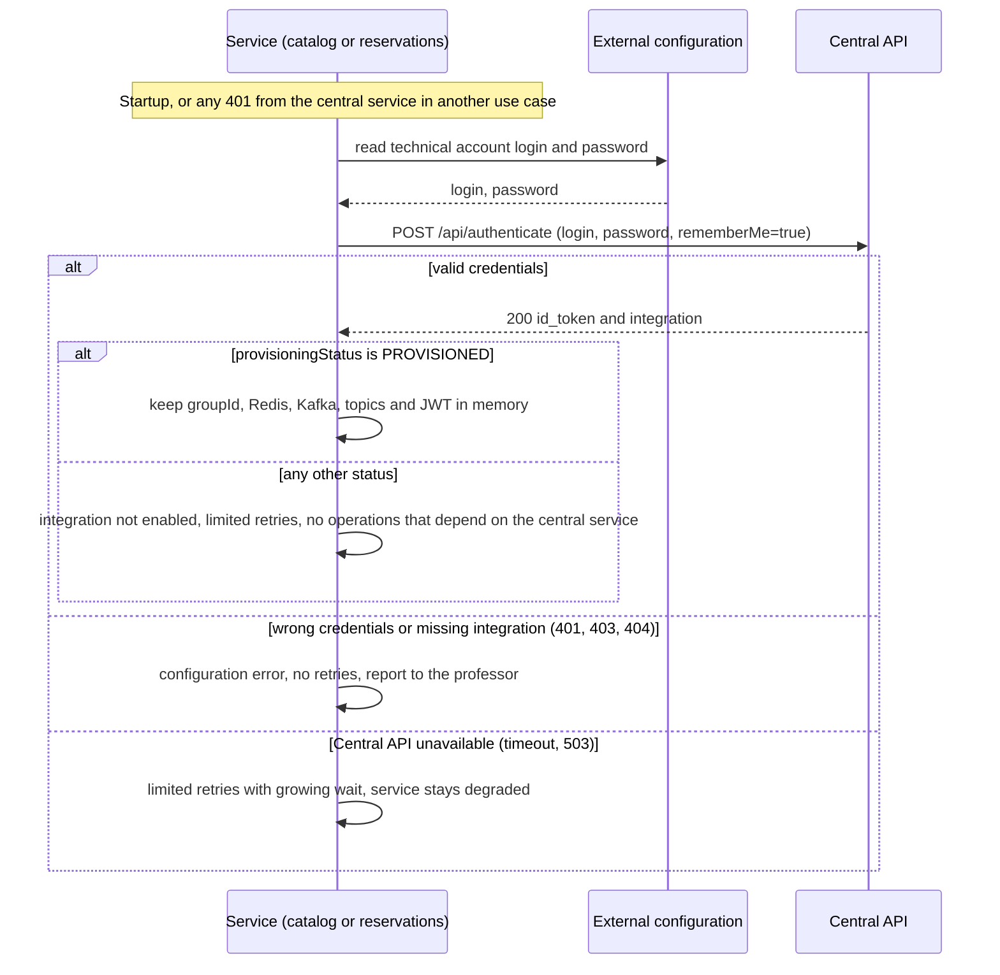

# Secuencias — cuenta técnica y configuración

## 1. Autenticación técnica y configuración (X01)

Caso de uso: X01. Lo ejecuta cada servicio por su cuenta, al arrancar y cada vez que la cátedra responde `401` en otro caso de uso.

