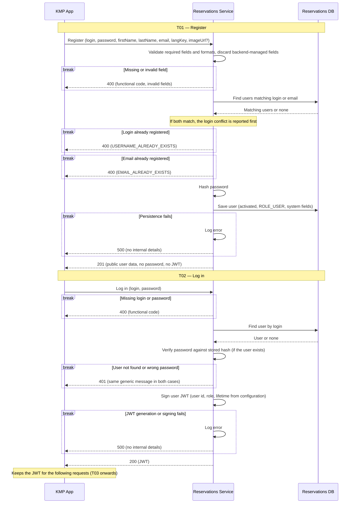
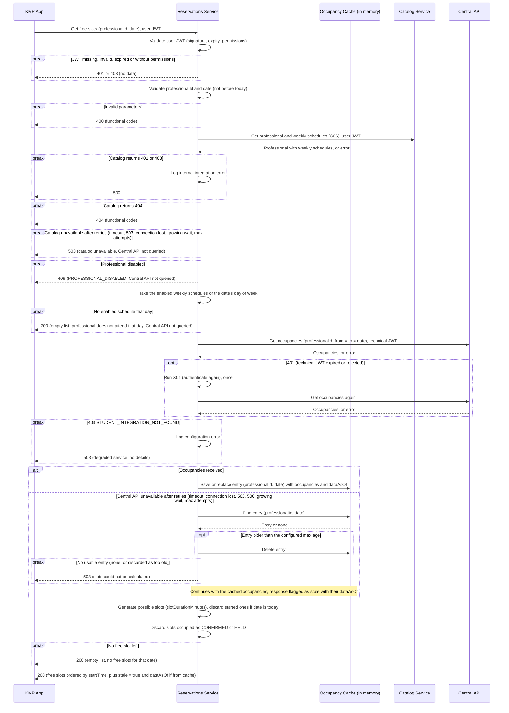
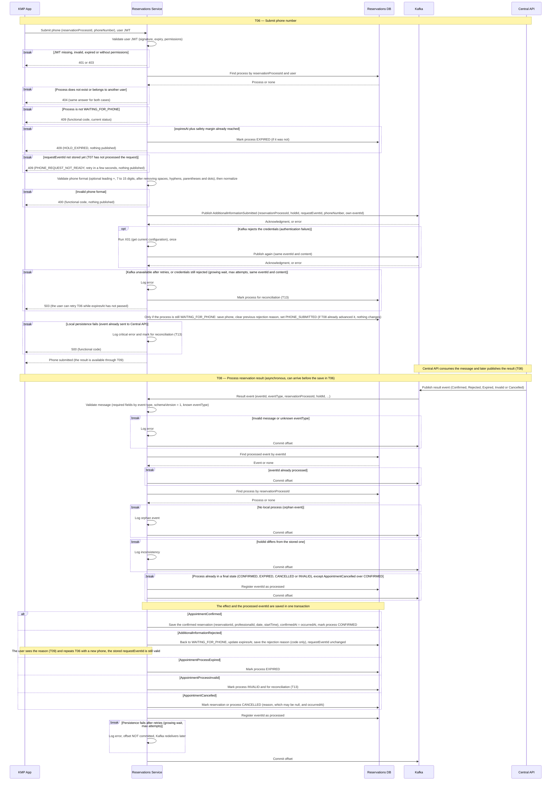
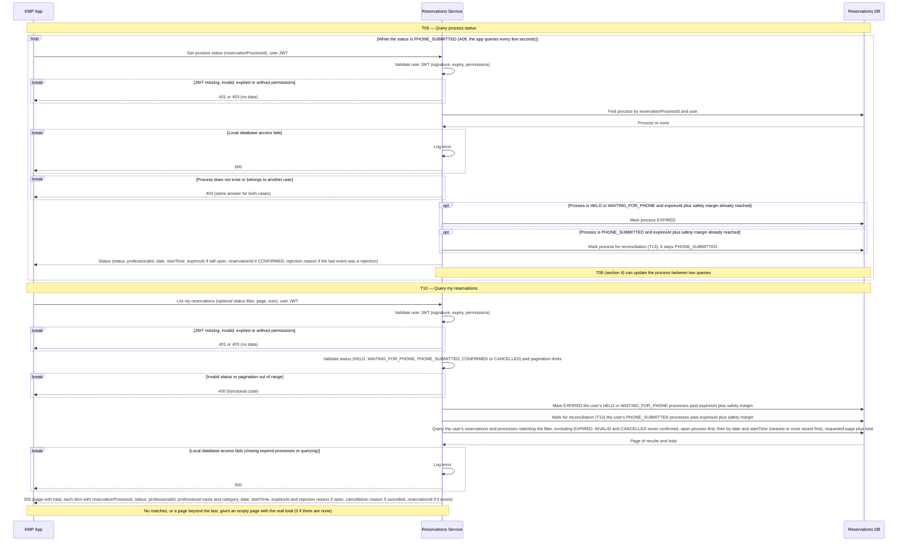
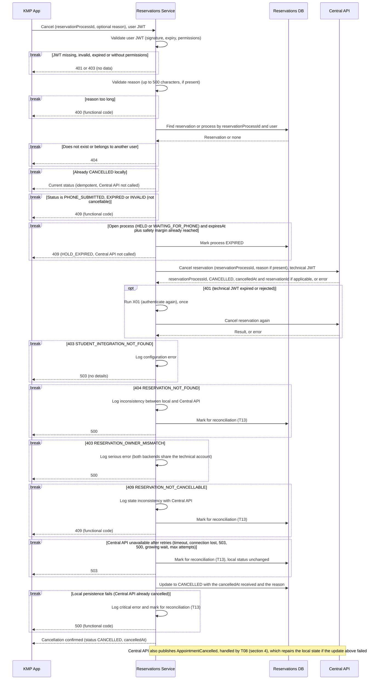
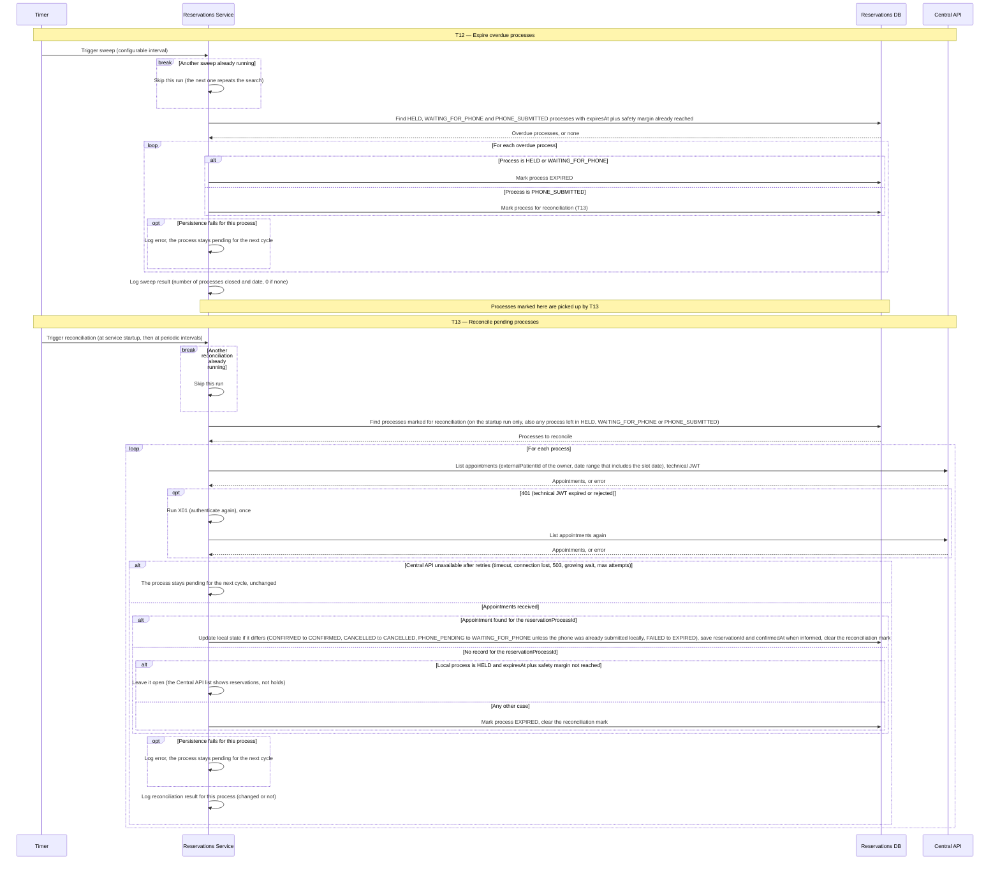

# Secuencias — turnos y reservas

## 1. Registro e inicio de sesión (T01, T02)

Casos de uso: T01 y T02.

## 2. Consulta de turnos libres con caché de respaldo (T03)

Casos de uso: T03.

## 3. Bloqueo del turno y confirmación inicial (T04, T05, T07)

Casos de uso: T04, T05 y T07.

```mermaid
sequenceDiagram
    participant App as KMP App
    participant Service as Reservations Service
    participant DB as Reservations DB
    participant Catalog as Catalog Service
    participant Central as Central API
    participant Kafka as Kafka

    Note over App,Kafka: T04 — Block the slot (create hold)
    App->>Service: Create hold (professionalId, date, startTime), user JWT
    Service->>Service: Validate user JWT (signature, expiry, permissions)
    break JWT missing, invalid, expired or without permissions
        Service-->>App: 401 or 403 (no data)
    end
    Service->>Service: Validate professionalId, date and startTime (slot not in the past)
    break Invalid parameters
        Service-->>App: 400 (functional code)
    end
    Service->>DB: Find an open process of the user (HELD, WAITING_FOR_PHONE or PHONE_SUBMITTED)
    DB-->>Service: Open process or none
    opt Process is HELD or WAITING_FOR_PHONE and expiresAt plus safety margin already reached
        Service->>DB: Mark process EXPIRED
    end
    break Process still open (not expired)
        Service-->>App: 409 (OPEN_PROCESS_EXISTS, with reservationProcessId, status and expiresAt)
    end

    Service->>Catalog: Get professional and weekly schedules (C06), user JWT
    Catalog-->>Service: Weekly schedules, or error
    break Catalog returns 401 or 403
        Service->>Service: Log internal integration error
        Service-->>App: 500
    end
    break Catalog returns 404
        Service-->>App: 404 (functional code)
    end
    break Catalog unavailable after retries (timeout, 503, connection lost, growing wait, max attempts)
        Service-->>App: 503 (operation cannot start, Central API not called)
    end
    Service->>Service: Check the slot falls inside an enabled weekly schedule of that day
    break Slot outside the enabled schedules
        Service-->>App: 400 (own functional code, Central API not called)
    end

    Service->>Central: Create hold (professionalId, date, startTime, externalPatientId), technical JWT
    Central-->>Service: Hold (holdId, reservationProcessId, HELD, expiresAt), or error
    opt 401 (technical JWT expired or rejected)
        Service->>Service: Run X01 (authenticate again), once
        Service->>Central: Create hold again
        Central-->>Service: Hold, or error
    end
    break 403 STUDENT_INTEGRATION_NOT_FOUND
        Service->>Service: Log configuration error
        Service-->>App: 503 (no details)
    end
    break 404 PROFESSIONAL_NOT_FOUND
        Service->>Service: Log error (catalog may be out of sync)
        Service-->>App: 404 (functional code)
    end
    break 400 PROFESSIONAL_DISABLED
        Service-->>App: 409 (functional code, professional no longer accepts appointments)
    end
    break 400 INVALID_SLOT
        Service-->>App: 400 (functional code)
    end
    break 409 SLOT_ALREADY_RESERVED or SLOT_ALREADY_HELD
        Service-->>App: 409 (same functional code for both, slot no longer available)
    end
    break Central API unavailable after retries (timeout, connection lost, 503, 500, growing wait, max attempts)
        Service-->>App: 503 (hold could not be created, no local process)
    end
    Service->>DB: Create process HELD (user, holdId, reservationProcessId, slot, expiresAt, professional name and category)
    break Local persistence fails (orphan hold in Central API)
        Service->>Service: Log critical error
        Service-->>App: 500 (functional code, expiresAt received from Central API, Retry-After header)
    end
    Service-->>App: Process created (reservationProcessId, status HELD, expiresAt)

    Note over App,Kafka: T05 — Confirm reservation (initial confirmation)
    App->>Service: Confirm (reservationProcessId), user JWT
    Service->>Service: Validate user JWT (signature, expiry, permissions)
    break JWT missing, invalid, expired or without permissions
        Service-->>App: 401 or 403 (no data)
    end
    Service->>DB: Find process by reservationProcessId and user
    DB-->>Service: Process or none
    break Process does not exist or belongs to another user
        Service-->>App: 404 (same answer for both cases)
    end
    break Process is not HELD
        Service-->>App: 409 (functional code, current status)
    end
    break expiresAt plus safety margin already reached
        Service->>DB: Mark process EXPIRED (if it was not)
        Service-->>App: 409 (HOLD_EXPIRED, Central API not called)
    end
    Service->>Central: Confirm hold (externalPatientId, patientFirstName and patientLastName from the user profile), technical JWT
    Central-->>Service: reservationProcessId, WAITING_FOR_PHONE and new expiresAt, or error
    opt 401 (technical JWT expired or rejected)
        Service->>Service: Run X01 (authenticate again), once
        Service->>Central: Confirm hold again
        Central-->>Service: Result, or error
    end
    break 403 STUDENT_INTEGRATION_NOT_FOUND
        Service->>Service: Log configuration error
        Service-->>App: 503 (no details)
    end
    break 404 HOLD_NOT_FOUND
        Service->>Service: Log error
        Service-->>App: 404 (functional code)
    end
    break 404 HOLD_EXPIRED
        Service->>DB: Mark process EXPIRED
        Service-->>App: 409 (HOLD_EXPIRED)
    end
    break 403 HOLD_OWNER_MISMATCH
        Service->>Service: Log serious error (both backends share the technical account)
        Service-->>App: 500
    end
    break 400 EXTERNAL_PATIENT_MISMATCH
        Service->>Service: Log error
        Service-->>App: 409 (functional code)
    end
    break 409 RESERVATION_PROCESS_ALREADY_CONFIRMED (probably an app retry)
        Service->>DB: Update local copy if outdated
        Service-->>App: Current status (not an error)
    end
    break 404 PROFESSIONAL_NOT_FOUND, 400 INVALID_SLOT or 409 SLOT_ALREADY_RESERVED
        Service->>Service: Log error
        Service-->>App: Matching functional code, same as T04
    end
    break Central API unavailable after retries (timeout, connection lost, 503, 500, growing wait, max attempts)
        Service->>DB: Mark process for reconciliation (T13), it stays HELD
        Service-->>App: 503
    end
    Service->>DB: Update process to WAITING_FOR_PHONE with the new expiresAt
    break Local persistence fails (Central API already advanced the process)
        Service->>Service: Log critical error and mark for reconciliation (T13)
        Service-->>App: 500 (functional code)
    end
    Service-->>App: Updated process (status WAITING_FOR_PHONE, expiresAt)

    Note over App,Kafka: T07 — Process additional information request (asynchronous, can finish before or after the last step of T05)
    Central->>Kafka: Publish AdditionalInformationRequested (when it confirms the hold in T05)
    Kafka->>Service: AdditionalInformationRequested (eventId, reservationProcessId, holdId, requiredField, expiresAt, ...)
    Service->>Service: Validate message (required fields, schemaVersion = 1, requiredField = PHONE_NUMBER)
    break Invalid message or unsupported requiredField
        Service->>Service: Log error or limitation
        Service->>Kafka: Commit offset
    end
    Service->>DB: Find processed event by eventId
    DB-->>Service: Event or none
    break eventId already processed
        Service->>Kafka: Commit offset
    end
    Service->>DB: Find process by reservationProcessId
    DB-->>Service: Process or none
    break No local process (orphan event)
        Service->>Service: Log orphan event
        Service->>Kafka: Commit offset
    end
    break holdId differs from the stored one
        Service->>Service: Log inconsistency
        Service->>Kafka: Commit offset
    end
    break Process is neither HELD nor WAITING_FOR_PHONE
        Service->>Service: Log (state already advanced, no going back)
        Service->>Kafka: Commit offset
    end
    Service->>DB: One transaction: save requestEventId, update expiresAt, HELD to WAITING_FOR_PHONE if needed, register eventId as processed
    break Persistence fails after retries (growing wait, max attempts)
        Service->>Service: Log error, offset NOT committed, Kafka redelivers later
    end
    Service->>Kafka: Commit offset
```

## 4. Envío del teléfono y resultado de la reserva (T06, T08)

Casos de uso: T06 y T08.

## 5. Consulta del estado y de mis reservas (T09, T10)

Casos de uso: T09 y T10.

## 6. Cancelación de reserva o proceso en curso (T11)

Casos de uso: T11.

## 7. Vencimiento y reconciliación periódicos (T12, T13)

Casos de uso: T12 y T13.

