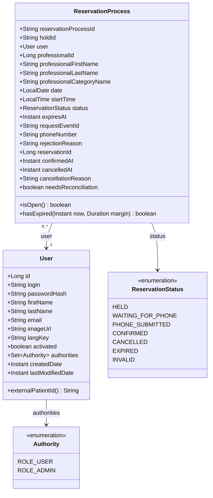
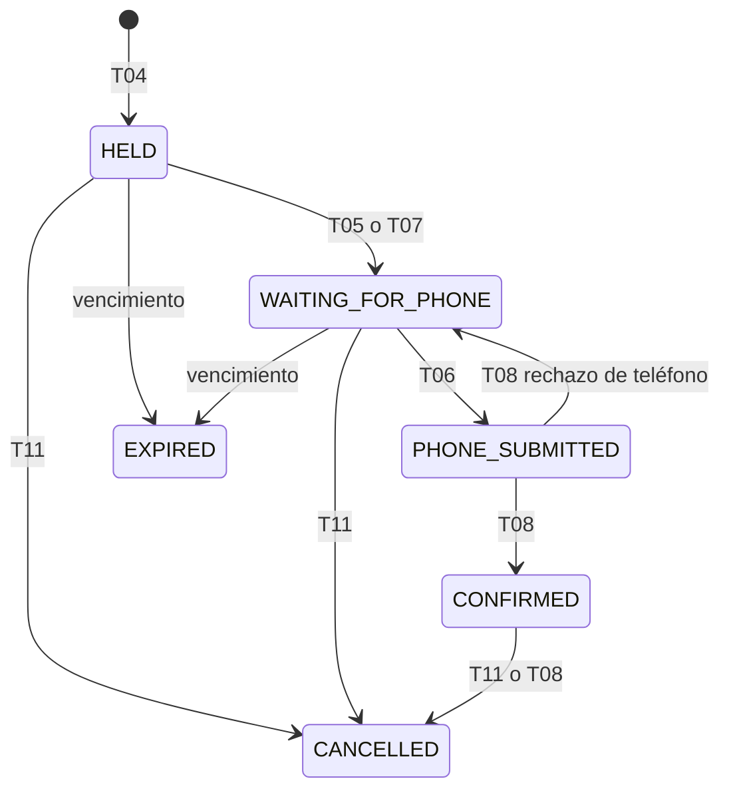
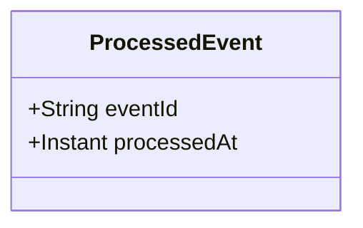

# Modelo de dominio — servicio de turnos y reservas

## 1. Usuarios y procesos de reserva

## 2. Estados del proceso

Además de las transiciones del diagrama, los eventos de la cátedra pueden cerrar un proceso desde cualquier estado abierto:

| Desde | Hacia | Causa |
| --- | --- | --- |
| Estado abierto | `CONFIRMED` | T08 (`AppointmentConfirmed`); T13 |
| Estado abierto | `EXPIRED` | T08 (`AppointmentProcessExpired`); T13 |
| `HELD` o `WAITING_FOR_PHONE` | `EXPIRED` | Cierre por vencimiento en T04, T05, T06, T09, T10, T11 y T12 |
| Estado abierto | `INVALID` | T08 (`AppointmentProcessInvalid`) |
| Estado abierto o `CONFIRMED` | `CANCELLED` | T08 (`AppointmentCancelled`); T13 |
| `HELD`, `WAITING_FOR_PHONE` o `CONFIRMED` | `CANCELLED` | T11 |

Los estados abiertos son `HELD`, `WAITING_FOR_PHONE` y `PHONE_SUBMITTED`.

## 3. Eventos procesados

## 4. Atributos

| Clase | Atributo | Tipo | Regla |
| --- | --- | --- | --- |
| `User` | `id` | `Long` | Lo genera el backend; nunca viene del cliente |
| `User` | `login` | `String` | De 3 a 50 caracteres; único. Es lo que la persona escribe al iniciar sesión; no es el JWT, que se emite en T02 y no se guarda |
| `User` | `passwordHash` | `String` | Hash de la contraseña; nunca se guarda en texto plano ni se devuelve |
| `User` | `firstName` | `String` | De 2 a 50 caracteres |
| `User` | `lastName` | `String` | De 2 a 50 caracteres |
| `User` | `email` | `String` | De 5 a 254 caracteres; único |
| `User` | `imageUrl` | `String` | Opcional |
| `User` | `langKey` | `String` | De 2 a 10 caracteres |
| `User` | `activated` | `boolean` | T01 lo crea en verdadero; el inicio de sesión (T02) requiere cuenta activa |
| `User` | `authorities` | `Set<Authority>` | T01 asigna `ROLE_USER`; `ROLE_ADMIN` no se asigna por ese medio |
| `User` | `createdDate` | `Instant` | Momento, en UTC, en que se creó el usuario |
| `User` | `lastModifiedDate` | `Instant` | Momento, en UTC, de la última modificación |
| `ReservationProcess` | `reservationProcessId` | `String` | Lo asigna la cátedra al conceder el hold; texto opaco, sin formato asumido; identifica al proceso y es la clave de los mensajes de Kafka |
| `ReservationProcess` | `holdId` | `String` | Lo asigna la cátedra al conceder el hold (T04) |
| `ReservationProcess` | `user` | `User` | Obligatorio; es el dueño del proceso |
| `ReservationProcess` | `professionalId` | `Long` | Referencia por ID al profesional del catálogo; turnos no guarda una copia del catálogo |
| `ReservationProcess` | `professionalFirstName` | `String` | Dato descriptivo al momento de la reserva, obtenido de C06 en T04 |
| `ReservationProcess` | `professionalLastName` | `String` | Dato descriptivo al momento de la reserva, obtenido de C06 en T04 |
| `ReservationProcess` | `professionalCategoryName` | `String` | Dato descriptivo al momento de la reserva, obtenido de C06 en T04 |
| `ReservationProcess` | `date` | `LocalDate` | Fecha del turno |
| `ReservationProcess` | `startTime` | `LocalTime` | Hora local de inicio del turno, sin zona horaria |
| `ReservationProcess` | `status` | `ReservationStatus` | Estado actual del proceso |
| `ReservationProcess` | `expiresAt` | `Instant` | Vencimiento del hold en la cátedra, en UTC; lo fija T04 y lo actualizan T05, T07 y el rechazo de teléfono de T08 |
| `ReservationProcess` | `requestEventId` | `String` | Vacío hasta que T07 recibe el pedido de teléfono; es el `eventId` de ese pedido y se envía como `requestEventId` al informar el teléfono (T06) |
| `ReservationProcess` | `phoneNumber` | `String` | Vacío hasta T06; es el último teléfono informado |
| `ReservationProcess` | `rejectionReason` | `String` | Código con que la cátedra rechazó el teléfono (por ejemplo `INVALID_PHONE_NUMBER`); vacío si no hay rechazo vigente |
| `ReservationProcess` | `reservationId` | `Long` | Lo asigna la cátedra al confirmar; vacío hasta entonces |
| `ReservationProcess` | `confirmedAt` | `Instant` | Momento, en UTC, en que se confirmó; vacío si nunca se confirmó |
| `ReservationProcess` | `cancelledAt` | `Instant` | Momento, en UTC, de la cancelación; vacío si no fue cancelado |
| `ReservationProcess` | `cancellationReason` | `String` | Motivo de la cancelación; opcional, hasta 500 caracteres |
| `ReservationProcess` | `needsReconciliation` | `boolean` | Verdadero si el estado local puede no coincidir con el de la cátedra y T13 debe reconciliarlo; por defecto falso |
| `ProcessedEvent` | `eventId` | `String` | Identidad del registro y clave de idempotencia (anexo §15.1) |
| `ProcessedEvent` | `processedAt` | `Instant` | Momento, en UTC, en que se terminó de procesar |

### Valores de `Authority`

| Valor | Significado |
| --- | --- |
| `ROLE_USER` | Usuario común; es el único rol que asigna T01 |
| `ROLE_ADMIN` | Administrador |

### Valores de `ReservationStatus`

| Valor | Significado | ¿Abierto? |
| --- | --- | --- |
| `HELD` | La cátedra concedió el hold (T04); falta la confirmación inicial (T05) o el pedido de teléfono (T07) | Sí |
| `WAITING_FOR_PHONE` | La cátedra pidió el teléfono; el usuario debe informarlo, o volver a informarlo tras un rechazo | Sí |
| `PHONE_SUBMITTED` | Turnos publicó el teléfono (T06) y espera el resultado de la cátedra | Sí |
| `CONFIRMED` | La cátedra confirmó la reserva | No |
| `CANCELLED` | Cancelado por el usuario (T11) o informado por la cátedra | No |
| `EXPIRED` | Venció antes de confirmarse | No |
| `INVALID` | La cátedra informó el proceso como inválido; queda marcado para que T13 lo reconcilie | No |

## 5. Reglas del modelo

| # | Regla |
| --- | --- |
| 1 | `login` y `email` son únicos sin distinguir mayúsculas |
| 2 | `externalPatientId()` vale `"user-" + id`, no se guarda, es estable y tiene hasta 100 caracteres; es el identificador del usuario ante la cátedra |
| 3 | `User` guarda `createdDate` y `lastModifiedDate`, pero no quién los hizo (`createdBy`, `lastModifiedBy`) |
| 4 | El proceso se identifica por `reservationProcessId`, un texto opaco que asigna la cátedra; turnos no genera identificadores propios para los procesos |
| 5 | Un usuario tiene como máximo un proceso abierto (`HELD`, `WAITING_FOR_PHONE` o `PHONE_SUBMITTED`); las reservas confirmadas no cuentan |
| 6 | Un evento tardío nunca reabre un proceso en estado final; las únicas excepciones son la cancelación de un proceso `CONFIRMED` y la corrección de T13. Lo mismo vale al revés: T06 solo pasa el proceso a `PHONE_SUBMITTED` si sigue en `WAITING_FOR_PHONE`, y no hace retroceder uno que T08 ya avanzó |
| 7 | `isOpen()` es verdadero en `HELD`, `WAITING_FOR_PHONE` y `PHONE_SUBMITTED`. `hasExpired(now, margin)` es verdadero si `now` supera `expiresAt` más el margen de seguridad, que es configurable |
| 8 | Un proceso vencido en `HELD` o `WAITING_FOR_PHONE` pasa a `EXPIRED`. Uno vencido en `PHONE_SUBMITTED` no se cierra: se marca `needsReconciliation`, porque la cátedra pudo haberlo confirmado |
| 9 | `needsReconciliation` lo limpia T13 al reconciliar el proceso; si la cátedra no responde, sigue marcado |
| 10 | `requestEventId` no cambia tras un rechazo de teléfono: sigue siendo válido para el próximo intento |
| 11 | `rejectionReason` solo lo escribe T08, y T06 lo borra al publicar un nuevo teléfono. La validación local del teléfono responde `400` y no se guarda |
| 12 | "Mis reservas" (T10) lista los procesos abiertos, los `CONFIRMED` y los `CANCELLED` que tienen `confirmedAt`. Los `EXPIRED`, los `INVALID` y los cancelados antes de confirmarse no se listan |
| 13 | Los datos del profesional (`professionalFirstName`, `professionalLastName`, `professionalCategoryName`) son una copia del momento de la reserva, para historial y para que T10 sea una lectura local. No se usan como catálogo vigente (enunciado §4.2) |
| 14 | Los procesos se guardan en la base de datos de turnos, no en memoria, y los cerrados no se borran de inmediato: T09 y la idempotencia de T11 los necesitan |
| 15 | La cátedra es la fuente de verdad de los turnos y de las reservas confirmadas, pero no conoce a los usuarios finales: la asociación entre usuario y proceso vive solo en turnos. Ante un conflicto, T13 conserva el estado de la cátedra |
| 16 | `date` y `startTime` son `LocalDate` y `LocalTime` (sin zona horaria) y los instantes son `Instant` en UTC |
| 17 | `ProcessedEvent` se identifica por `eventId` y se registra por cada mensaje de Kafka que turnos consume (T07 y T08), en la misma transacción que el cambio de estado y antes de confirmar el offset. Si llega un `eventId` ya registrado, no se repite ningún efecto y se confirma el offset |
| 18 | El caché de ocupaciones de T03 no es una entidad del dominio: vive en memoria, con clave (`professionalId`, `date`), y guarda la lista de ocupaciones (`startTime`, `status`, `expiresAt`) y el `dataAsOf`. Solo se usa si la cátedra no responde y el `dataAsOf` no supera la antigüedad máxima configurada. El caché no conserva entradas más viejas que la antigüedad máxima configurada: las descarta por sí mismo al vencer y también al encontrarlas vencidas en una consulta (T03, 5.3). |
